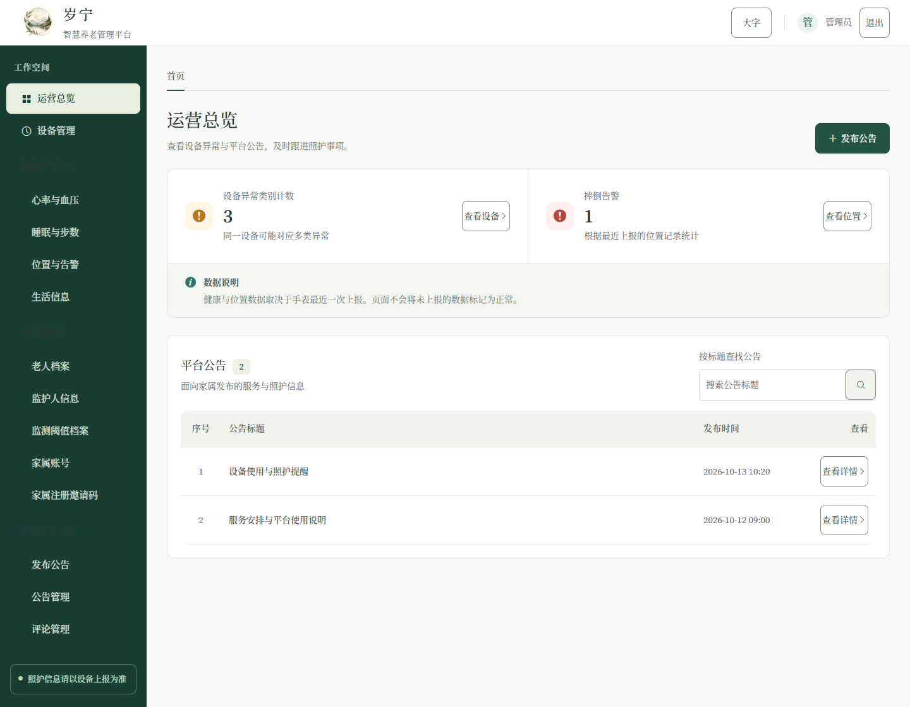
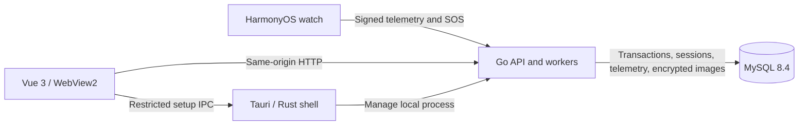

> **Current `preview`: MySQL 8.4 only.** Previous PostgreSQL/S3 deployments require an explicit migration; see [MySQL migration](docs/MYSQL_ONLY_MIGRATION.md).

<p align="center">
  
</p>

<h1 align="center">Suining · Elderly Care Management</h1>

<p align="center">Companionship through the years. Peace in everyday life.<br>An open-source watch management platform connecting residents, families, and care staff.</p>

<p align="center">
  <a href="README.md">简体中文</a> · <a href="README.en.md">English</a>
</p>

[](https://github.com/WatchTestCs/smart-elderly-watch-management/actions/workflows/ci.yml)

[Download](#download) · [Features](#features) · [Getting started](#getting-started) · [Architecture](#architecture) · [Source and builds](#source-and-builds) · [Validation and performance](#validation-and-performance) · [Documentation](#documentation)

Suining brings resident profiles, watch devices, health records, location alerts, and care tasks into a single workspace for care organizations and families. The application is built with Tauri 2, Rust, Vue 3, Vite, and Go, using MySQL 8.4 as its sole persistent application datastore.

This branch also includes [SuiningWatch](SuiningWatch/README.md), a native HarmonyOS (ArkTS) watch app used to test device-to-backend protocols in the emulator. See the [watch integration notes](docs/WATCH_INTEGRATION.md) for build and test details. The watch app includes foreground heart-rate and step sensors, permission requests, device authentication, health uploads and SOS. Simulated samples remain a separate debugging source. Native SDK builds, signing and physical-watch validation use the setup described in the watch guide.



*Interface preview populated with test data.*

## Branches and releases

`preview` is the development and prerelease-validation branch; `main` is the stable-candidate branch. Feature and documentation pull requests target `preview`. On 2026-11-12 the validated commit `e1e268f` was promoted to `main`, while the previous main head was preserved under `history/main-before-preview-20261112-ac5f2d5`. **Promotion to `main` is not a published release.** Check the [Stable release candidate workflow](https://github.com/WatchTestCs/smart-elderly-watch-management/actions/workflows/stable-candidate.yml), an official tag for the same commit, and [GitHub Releases](https://github.com/WatchTestCs/smart-elderly-watch-management/releases) for release status. See the [promotion runbook](docs/reliability/main-promotion.md).

## Download

The following files belong to the previously published 2.1.0 · Windows x64 preview release, not necessarily the current `main` head.

| Package | Download | Best for |
| --- | --- | --- |
| Installer | [Windows Setup](https://github.com/WatchTestCs/smart-elderly-watch-management/releases/download/v2.1.0/Suining-Setup-2.1.0-win-x64.exe) | Standard standalone installation on a new machine |
| Portable | [Portable ZIP](https://github.com/WatchTestCs/smart-elderly-watch-management/releases/download/v2.1.0/Suining-Portable-2.1.0-win-x64.zip) | Running from an extracted folder with WebView2 already installed |
| Release source | [Source ZIP](https://github.com/WatchTestCs/smart-elderly-watch-management/releases/download/v2.1.0/Suining-Source-2.1.0.zip) | Reproducing the exact v2.1.0 tag including database migration scripts |

Verification: [SHA-256 checksums](https://github.com/WatchTestCs/smart-elderly-watch-management/releases/download/v2.1.0/SHA256SUMS.txt) · [Release notes](https://github.com/WatchTestCs/smart-elderly-watch-management/releases/tag/v2.1.0)

The packages do not bundle a database server. End users do not need Go, Rust, or Node.js installed. The Windows binaries are currently unsigned.

> [!NOTE]
> The v2.1.0 release assets were built from commit [e3cf064](https://github.com/WatchTestCs/smart-elderly-watch-management/commit/e3cf064). To test newer changes on `preview`, build from source using the instructions below.

Use the named source archive and checksums from the Release to reproduce its build; GitHub-generated source ZIPs may have a different layout. Installers do not migrate legacy databases or local images.

## Features

| Area | What it covers |
| --- | --- |
| Residents and families | Manage resident, guardian, and family profiles; validate guardian references and guardian ages (integers from 0 to 150); protect assigned guardians from deletion; invite family members with registration codes |
| Watch devices | Register and bind watches, verify device secrets, check online status, and set alert thresholds |
| Health and daily life | View heart rate, single-value blood pressure, sleep phases, step counts, and daily care logs |
| Location and alerts | View reported locations, SOS and explicit fall types; show independent sampling context and mark unknown or historical positions |
| Care coordination | Claim alert tasks and log interventions; the reviewing supervisor must be neither the current assignee nor the resolver; manual and timeout escalation durably enqueue configured fallback notifications; reconcile an uncertain write in the same dialog, retain notes, and block obsolete actions |
| Announcements | Publish illustrated notices and moderate comments across administrator and family views |
| Desktop accessibility | Toggle large-text mode, navigate by keyboard, use `F11` fullscreen, and adapt to narrow screens; the top Settings button opens display, motion, and map preferences, with a shared text-size setting across sign-in, registration, and settings |

In day-to-day operation, staff create a resident profile, register and bind a watch, receive incoming telemetry, handle generated alert tasks, and have a second supervisor review completed interventions.

Access is scoped by role. Family accounts only see their linked residents. Supervisors have full administrative access, while caregivers and auditors are restricted to the care coordination workflow and their own two-factor authentication (2FA) settings.

## Getting started

### Windows desktop

The installer and portable package do not include a database server. This `preview` candidate requires **MySQL 8.4 only**. Older PostgreSQL and S3 settings are rejected by the new backend.

1. Start MySQL 8.4 and create the application's database and credentials. For upgrades, complete the [MySQL-only migration and image import](docs/MYSQL_ONLY_MIGRATION.md) with a tested backup and all old writers stopped.
2. Configure the database and persist an independently generated 32-byte encryption key (base64). For a controlled local loopback example in PowerShell 7:

```powershell
$env:SUINING_MYSQL_DSN='suining:REPLACE_PASSWORD@tcp(127.0.0.1:13306)/suining?parseTime=true'
$env:SESSION_BACKEND='database'
$env:DATA_ENCRYPTION_KEY='REPLACE_WITH_SAVED_BASE64_OF_32_RANDOM_BYTES'
& '.\suining.exe'
```

3. Once MySQL migrations have succeeded, follow the setup flow to create the first administrator. No default administrator credentials are bundled. Create resident records before binding watches.

Preserve the encryption key with database backups. Encrypted images live in MySQL (`image_payload`), so include binary columns when backing up. Verify TLS for any database connection beyond the trusted local host. A desktop instance closes its local backend when the window exits; unattended watch reporting and SOS require a continuously running server and a staffed notification path.

### Local Compose environment

From the repository root, use the single-MySQL stack:

```powershell
python scripts/start-platform.py
python scripts/bootstrap-admin.py
```

`deploy/platform.compose.yml` contains MySQL 8.4, the Go API, Nginx, and monitoring services. It does not provision PostgreSQL, S3 or a local-image runtime. The gateway binds `127.0.0.1:8080` by default; Prometheus binds `127.0.0.1:9090`. Before exposing any endpoint remotely, configure ingress TLS, access control and trusted proxy CIDRs. See the [deployment runbook](docs/MYSQL_ONLY_MIGRATION.md) for backup and rollback checks.

### Application architecture



MySQL is the only authoritative application datastore. Historical analytics table names and legacy status fields may remain to preserve contracts, but there is no live PostgreSQL analytics worker. When MySQL is down or the image migration is incomplete, business APIs stay unavailable rather than serving an inconsistent dataset. `/healthz` reports process liveness and `/api/v1/service/status` reports readiness. See [Workspace](docs/WORKSPACE.md), [API contracts](docs/API_CONTRACTS.md), and [MySQL migration](docs/MYSQL_ONLY_MIGRATION.md).

## Source and builds

Active development happens on `preview`. To reproduce a published release binary, use the matching source archive from the downloads table above.

```sh
git clone --branch preview https://github.com/WatchTestCs/smart-elderly-watch-management.git
cd smart-elderly-watch-management
```

```text

├── desktop/     Tauri / Rust shell, native permissions, and Windows packaging scripts
├── backend/     Go API, SQL migrations, care workflows, and analytics workers
├── frontend/    Vue 3 / Vite web interface and Playwright browser QA
└── watch-sim/   Watch protocol simulator
SuiningWatch/    HarmonyOS (ArkTS) wearable simulator project
deploy/          Docker Compose, database, and monitoring configurations
scripts/         Platform bootstrap, OpenAPI generator, and benchmark scripts
tests/           UI smoke tests
docs/            Architecture guides, deployment runbooks, release notes, and test logs
evidence/        Archived test outputs and fault-injection evidence
```

Building the Windows desktop package requires PowerShell 7, Node.js (`^20.19.0 || >=22.12.0`), Go (`1.27.4` per `go.mod`), Rust 1.85+, MSVC build tools, and the Windows SDK. See [Environment setup](docs/BUILD.md) for exact version constraints.

```powershell
# Work from the repository root
./desktop/validate-version.ps1
./desktop/build.ps1
```

The build script compiles the Vue frontend, embeds the assets into the Go binary, generates the sidecar SHA-256 manifest, builds the Tauri shell, and packages the NSIS installer into `outputs/v2.1.0-preview`.

### Watch simulator and offline runs

The Rust watch simulator can connect to preview or generate local data without a network, backend, or account. Building it requires Rust 1.89+ and, on Windows, MSVC and the Windows SDK.

```powershell
cargo build --release --locked --manifest-path watch-sim/Cargo.toml
.\watch-sim\target\release\watch-sim.exe --local "D:\watch-sim\local-data" --scenario demo --health-samples
```

Packaged builds include `本地模拟.cmd` for double-click startup. Each run creates a separate directory containing samples, events, and an `index.html` page that opens offline. See the [simulator guide](watch-sim/README.md) for online options, certificates, and validation commands.

Compared with the preview Node simulator, the Rust build reduced startup plus three-request time by 79.5% and peak working set by 85.2%. Coverage, adaptations and raw measurements are performance evidence and are not distributed with this repository.

## Validation

UI Quality runs with every Preview CI. `Core CI / required` covers the core checks; a formal candidate also requires native HAP compilation, actual Windows distribution tests, and complete evidence for the same SHA. See the [release gates](docs/reliability/release-governance.md) for inputs and rejection conditions.

| Area | Current reference |
| --- | --- |
| Preview branch automation | [Preview CI](https://github.com/WatchTestCs/smart-elderly-watch-management/actions/workflows/ci.yml) |
| Current release notes | [Version 2.1.0](docs/releases/2.1.0.md) and the release manifest |
| Backend regression | Run `go test -count=1 ./...` and `go vet ./...` in `backend` |
| Frontend build | Run `npm ci` and `npm run build` in `frontend` |
| Watch protocol | Run `npm ci` and `npm test` in `SuiningWatch`; this does not replace native DevEco or physical-device validation |

Database integration and race tests require dedicated disposable test databases configured through `TEST_MYSQL_DSN`. Tests must never target production databases. CI results must be read from the workflow run for the exact commit being assessed.

Historical performance experiments and release-stage notes are not current-version acceptance evidence. Before production deployment, separately validate physical watch hardware, external notification gateways, production data migration, network TLS, and staffed incident response. Gateway acceptance does not prove notification delivery or completed care response.
## Troubleshooting

| Symptom | What to check |
| --- | --- |
| The window opens, but login or saving fails | Verify MySQL connectivity, database name, migration status, `SESSION_BACKEND`, and `DATA_ENCRYPTION_KEY` |
| Legacy PostgreSQL connection variables are configured | Remove the unsupported variables and follow the MySQL-only migration guide before restarting |
| A watch cannot reach the desktop app | The desktop client only listens on localhost; deploy the Go server on a reachable host for external devices |
| The portable build fails to launch | Extract the entire ZIP, keep both `.exe` files in the same directory, ensure WebView2 is installed, and verify the SHA-256 hash |

## Documentation

| Topic | Guides |
| --- | --- |
| Releases and upgrades | [2.1.0 release notes](docs/releases/2.1.0.md) · [Changelog](CHANGELOG.md) |
| Databases and backups | [Current MySQL migration](docs/MYSQL_ONLY_MIGRATION.md) · [Backup and restore runbook](docs/runbooks/backup-restore.md) |
| Operations and support | [Care service deployment](docs/CARE_SERVICE_DEPLOYMENT.md) · [Support and troubleshooting](docs/SUPPORT.md) |
| Module guides | [Workspace overview](docs/WORKSPACE.md) · [Frontend](frontend/README.md) · [Backend](backend/README.md) · [Watch app](SuiningWatch/README.md) |
| Architecture and testing | [Architecture](docs/ARCHITECTURE.md) · [UI requirements](docs/UI_UX.md) · [Release gates](docs/reliability/release-governance.md) · [Testing guide](docs/TESTING.md) |

When opening an [issue](https://github.com/WatchTestCs/smart-elderly-watch-management/issues), include the application version or commit SHA, OS, network layout, and redacted logs.

Licensed under the [MIT License](LICENSE). Bundled fonts, map tiles, and third-party libraries remain under their respective licenses.

> **Breaking API change:** The `preview` branch serves API routes exclusively under `/api/v1/` and removes unversioned `/api/` aliases. Browser session cookies now use the name `SUINING_SESSION`.

## API contract

[API contracts and resolved differences](docs/API_CONTRACTS.md) list request and success fields for the currently documented routes. JSON success uses HTTP 200 and `returnCode="1111"`. Failures use HTTP 4xx/5xx with `returnCode="0000"`, `code`, `message` and an optional `reference`. Image downloads return bytes; uploads use multipart field `file`.

Device requests use `X-Device-Signature`, `X-Device-Timestamp` and `X-Device-Nonce`. With `SUINING_REQUIRE_SIGNED_DEVICE=1`, every device route requires a valid signature and rejects nonce replay, except `/device/report` and `/device/sos` (which reserve nonces inside their business transaction) and `/care/receipt` (which uses the gateway HMAC). Without the variable, legacy unsigned firmware still works, but any signature that is present must verify.

A `/device/report` carrying a valid `requestId` is idempotent at the transaction level: resending the same number with identical content returns the original success response (`duplicate=true`) without a second write, while reusing the number with different content returns 409. Legacy reports without a request ID keep their previous behaviour. With the durable telemetry queue enabled (`SUINING_DURABLE_TELEMETRY=1`), that path keeps its existing unique-key 409 semantics.
