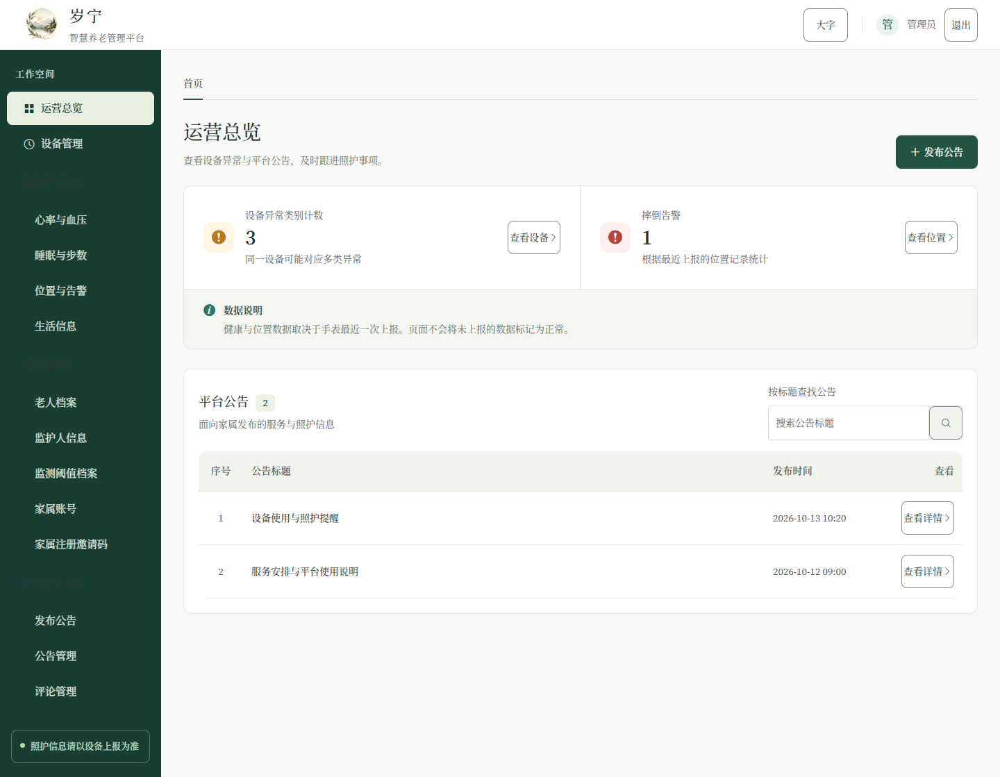
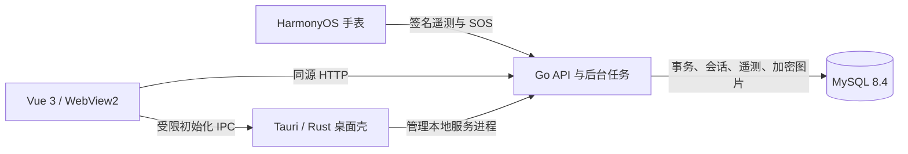

> **当前 `preview`：仅使用 MySQL 8.4。** PostgreSQL/S3 旧版本须按 [迁移手册](docs/MYSQL_ONLY_MIGRATION.md) 明确迁移。

<p align="center">
  
</p>

<h1 align="center">岁宁 · 智慧养老管理</h1>

<p align="center">岁月有伴，日常安宁。<br>连接长者、家属与照护人员的开源手表管理平台。</p>

<p align="center">
  <a href="README.md">简体中文</a> · <a href="README.en.md">English</a>
</p>

[](https://github.com/WatchTestCs/smart-elderly-watch-management/actions/workflows/ci.yml)

[下载](#下载) · [主要功能](#主要功能) · [开始使用](#开始使用) · [系统架构](#系统架构) · [源码与构建](#源码与构建) · [验证与性能](#验证与性能) · [文档导航](#文档导航)

岁宁面向照护机构与家属，在同一工作台内集中管理长者档案、手表设备、健康记录、位置告警与照护任务。客户端与服务端基于 Tauri 2、Rust、Vue 3、Vite 与 Go 构建，使用独立部署的 MySQL 保存业务数据，，仅使用 MySQL 8.4 持久化业务数据。

仓库根目录下的 [SuiningWatch](SuiningWatch/README.md) 是配套的 HarmonyOS 手表端工程，包含前台心率与计步传感器读取、系统权限申请、设备认证、采样上传和 SOS。模拟采样保留为独立调试来源；构建与接入步骤见[手表接入说明](docs/WATCH_INTEGRATION.md)。



*上图为使用测试数据的界面示例，仅供预览布局。*

## 分支与发布

`preview` 用于日常开发和预发布验证，`main` 用于稳定候选验收；普通功能和文档 PR 均以 `preview` 为目标。2026-11-12 已将通过预览候选门禁的提交 `e1e268f` 晋升到 `main`，旧主线保存在 `history/main-before-preview-20261112-ac5f2d5`。**进入 `main` 不等于已经发布新版本**。正式交付须以 [Stable release candidate](https://github.com/WatchTestCs/smart-elderly-watch-management/actions/workflows/stable-candidate.yml) 的成功运行、同 SHA 的正式标签及 [GitHub Releases](https://github.com/WatchTestCs/smart-elderly-watch-management/releases) 为准。完整流程见 [晋升手册](docs/reliability/main-promotion.md)。

## 下载

以下是已发布的 2.1.0 · Windows x64（预览版）附件，不代表当前 `main` 的最新构建。

| 版本类型 | 下载链接 | 适用场景 |
| --- | --- | --- |
| 安装版 | [Windows Setup](https://github.com/WatchTestCs/smart-elderly-watch-management/releases/download/v2.1.0/Suining-Setup-2.1.0-win-x64.exe) | 独立安装程序，适合首次部署 |
| 免安装版 | [Portable ZIP](https://github.com/WatchTestCs/smart-elderly-watch-management/releases/download/v2.1.0/Suining-Portable-2.1.0-win-x64.zip) | 解压即用，完整解压后运行，需已有 WebView2 |
| 发布源码 | [Source ZIP](https://github.com/WatchTestCs/smart-elderly-watch-management/releases/download/v2.1.0/Suining-Source-2.1.0.zip) | 与标签版本完全一致，包含数据库迁移脚本 |

校验与发布信息：[SHA-256](https://github.com/WatchTestCs/smart-elderly-watch-management/releases/download/v2.1.0/SHA256SUMS.txt) · [完整发布记录](https://github.com/WatchTestCs/smart-elderly-watch-management/releases/tag/v2.1.0)

安装包不含数据库服务，运行客户端无需安装 Go、Rust 或 Node.js。当前 Windows 安装包与执行文件未做数字签名。复现发行构建使用 Release 的命名源码附件与校验清单，GitHub 自动生成的源码 ZIP 目录结构可能不同；安装包不自动迁移旧数据库与本地图片。

> [!NOTE]
> v2.1.0 发行附件基于固定提交 [e3cf064](https://github.com/WatchTestCs/smart-elderly-watch-management/commit/e3cf064) 构建。如需体验后续提交的改动，请按下文说明从源码构建。

## 主要功能

| 模块 | 功能范围 |
| --- | --- |
| 长者与家庭 | 管理长者、监护人和家属档案；校验有效监护人关联及监护人的 0–150 岁整数年龄，保护仍被长者引用的监护人；生成家属注册邀请码 |
| 手表设备 | 登记与绑定设备、校验设备密钥、查看在线状态、设置监测阈值 |
| 健康与日常 | 查询心率、单项血压、睡眠、步数和日常生活记录 |
| 位置与告警 | 查看上报位置、异常、SOS 与明确摔倒类型；展示独立采样来源/时间/精度，标记未知与历史位置 |
| 照护协作 | 接单、开始处置、记录措施；复核主管不得为当前接单人或处置人；人工升级与超时升级均按配置持久化通知；操作结果不确定时可在原对话框核对任务状态，保留记录并阻止过期动作重复提交 |
| 公告与互动 | 发布图文公告、管理评论，区分管理端与家属端视图 |
| 桌面无障碍 | 支持大字模式、全键盘操作、`F11` 全屏及窄屏自适应布局；顶部“设置”可配置显示、动画与地图，大字偏好在登录、注册和设置面板间同步 |

日常业务按以下顺序流转：建立长者档案，登记并绑定手表，接收健康与位置上报，触发告警并生成工单，照护人员接单处置，最后由另一名主管独立复核。

系统按角色隔离权限：家属只能查看已关联长者的记录；主管拥有完整后台管理权限；护理员与审计员仅限访问照护协作页面及个人双因素认证（2FA）设置。

## 开始使用

### Windows 桌面端

当前 `preview` 候选版**仅使用 MySQL 8.4** 作为持久化业务数据库。安装包和便携版均不包含数据库服务。旧 PostgreSQL、S3 配置不能用于新后端。

1. 配置 MySQL 8.4 数据库及独立账号。升级旧版本时，先停止所有旧版写入服务，按 [MySQL 单库迁移手册](docs/MYSQL_ONLY_MIGRATION.md) 备份并导入历史图片。
2. 生成并妥善保存随机 32 字节数据加密密钥（base64）。PowerShell 7 本地示例：

```powershell
$env:SUINING_MYSQL_DSN='suining:替换密码@tcp(127.0.0.1:13306)/suining?parseTime=true'
$env:SESSION_BACKEND='database'
$env:DATA_ENCRYPTION_KEY='替换为已备份的32字节随机密钥的base64'
& '.\suining.exe'
```

3. 数据库迁移成功后，按界面提示创建首位管理员。系统没有默认管理员密码。先创建长者档案，再登记与绑定手表。

加密图片存入 MySQL `image_payload`，备份时必须包含 BLOB 数据及数据密钥。跨主机连接数据库须校验 TLS。桌面端关闭时会停止其本地 Go 服务；持续接收手表上报和 SOS 需要独立常驻的 Go 服务及真实值守通知渠道。

### 本地容器化平台

从仓库根目录运行：

```powershell
python scripts/start-platform.py
python scripts/bootstrap-admin.py
```

[Compose 配置](deploy/platform.compose.yml) 仅部署 MySQL 8.4、Go 服务、Nginx 和监控组件，不再部署 PostgreSQL、S3 或运行时本地图片目录。默认网关绑定 `127.0.0.1:8080`，Prometheus 绑定 `127.0.0.1:9090`。跨网络开放前须配置 TLS、访问控制和可信代理范围。数据迁移及回滚要求见 [MySQL 单库迁移手册](docs/MYSQL_ONLY_MIGRATION.md)。

### 系统架构



MySQL 是唯一权威业务数据存储。部分历史分析表名和旧状态响应字段为兼容接口而保留，但不再运行 PostgreSQL 分析投影。MySQL 不可用或历史图片迁移未完成时，业务 API 保持不可用，避免返回不一致数据。`/healthz` 用于存活检测，`/api/v1/service/status` 用于就绪检查。详见 [工作区说明](docs/WORKSPACE.md)、[接口约定](docs/API_CONTRACTS.md) 和 [MySQL 单库迁移](docs/MYSQL_ONLY_MIGRATION.md)。

## 源码与构建

日常开发基于 `preview` 分支；如需复现已发布的安装包，请直接下载上方的发行版源码包。

```sh
git clone --branch preview https://github.com/WatchTestCs/smart-elderly-watch-management.git
cd smart-elderly-watch-management
```

```text

├── desktop/     Tauri / Rust 桌面壳、原生权限与 Windows 打包脚本
├── backend/     Go API、数据库迁移、照护工单与分析投影作业
├── frontend/    Vue 3 / Vite 前端界面与 Playwright 浏览器测试
└── watch-sim/   手表上报协议模拟器
SuiningWatch/    HarmonyOS (ArkTS) 穿戴端模拟工程
deploy/          Docker Compose、数据库与监控告警配置
scripts/         平台启动、OpenAPI 生成与基准测试脚本
tests/           UI 冒烟测试
docs/            架构设计、部署手册、版本说明与验证记录
evidence/        自动化测试与故障演练留档数据
```

在 Windows 上执行完整桌面构建，需要安装 PowerShell 7、Node.js（`^20.19.0 || >=22.12.0`）、Go（`go.mod` 要求 `1.27.4`）、Rust 1.85+、MSVC 生成工具与 Windows SDK。具体环境准备见[构建环境说明](docs/BUILD.md)。

```powershell
# Work from the repository root
./desktop/validate-version.ps1
./desktop/build.ps1
```

构建脚本依次编译 Vue 静态资源、内嵌静态资源的 Go 服务端、sidecar SHA-256 校验文件、Tauri 原生壳以及 NSIS 安装包，最终产物输出到 `outputs/v2.1.0-preview`。

### 手表模拟器与本地模拟

手表模拟器现使用 Rust，可独立连接 preview，也可在无网络、后端或账号时保存本地模拟数据。构建模拟器需要 Rust 1.89+；Windows 还需 MSVC 与 Windows SDK。

```powershell
cargo build --release --locked --manifest-path watch-sim/Cargo.toml
.\watch-sim\target\release\watch-sim.exe --local "D:\手表模拟\本地数据" --scenario demo --health-samples
```

发布包可双击 `本地模拟.cmd`。每次运行创建独立目录，保存采样、事件与可离线打开的 `index.html`。联机参数、证书和验证命令见[模拟器说明](watch-sim/README.md)。

与远端 Node 模拟器的对照显示，Rust 的三请求启动耗时降低79.5%、峰值工作集降低85.2%；功能覆盖、适配与原始测量数据属性能证据，未随仓库分发。

## 验证与性能

UI Quality 随每次 Preview CI 执行。`Core CI / required` 仅表示基础检查通过；正式候选还需原生 HAP、实际 Windows 安装包测试和同一 SHA 的完整证据，操作与失败条件见[发布门禁](docs/reliability/release-governance.md)。

| 验证维度 | 当前依据 |
| --- | --- |
| 分支自动化检查 | [Preview CI](https://github.com/WatchTestCs/smart-elderly-watch-management/actions/workflows/ci.yml) |
| 当前版本发布信息 | [2.1.0 版本说明](docs/releases/2.1.0.md)及发行附件中的 manifest |
| 后端回归 | 在 `backend` 中执行 `go test -count=1 ./...` 与 `go vet ./...` |
| 前端构建 | 在 `frontend` 中执行 `npm ci` 与 `npm run build` |
| 手表协议 | 在 `SuiningWatch` 中执行 `npm ci` 与 `npm test`；这不等同于 DevEco 原生编译或真机验收 |

如需运行完整数据库集成与竞态测试，请先配置专用测试库环境变量 `TEST_MYSQL_DSN`，再执行 `go test -race -count=1 -timeout 600s ./...`（未配置时数据库集成用例会自动跳过）。

仓库当前 CI 结果以对应提交的 GitHub Actions 检查为准。性能实验、旧版本构建记录和阶段性补丁报告不再作为当前版本能力或验收结论；正式投入生产前，仍需针对真实穿戴硬件、外部短信或语音网关、生产数据迁移、跨网 TLS 证书及值班响应流程开展独立验收。通知发送成功仅代表网关已受理，实际照护结果以人工跟进与复核记录为准。
## 常见问题

| 现象 | 排查方向 |
| --- | --- |
| 界面能打开，但无法登录或保存 | 检查 MySQL 是否启动、库名是否正确、迁移是否完成，以及 `SESSION_BACKEND` 和 `DATA_ENCRYPTION_KEY` 是否有效 |
| 仍配置 PostgreSQL 连接变量 | 新版不再支持；移除旧配置并执行 MySQL 单库迁移后重新启动 |
| 外部手表无法连接桌面端服务 | 桌面端默认仅监听本机回环地址，外部设备接入需独立部署服务端并开放受控网络端口 |
| 免安装版双击无法启动 | 确认已完整解压 ZIP、主程序与 Go sidecar 位于同一目录、系统已安装 WebView2，并核对 SHA-256 |

## 文档导航

| 主题 | 相关文档 |
| --- | --- |
| 首次使用、功能入口与问题解决清单 | [用户使用指南](docs/USER_GUIDE.md) |
| 下载、版本与升级 | [2.1.0 发布说明](docs/releases/2.1.0.md) · [更新日志](CHANGELOG.md) |
| 数据库、迁移与备份 | [双库配置指南](docs/DUAL_DATABASES.md) · [备份与恢复手册](docs/runbooks/backup-restore.md) |
| 设备接入与照护运维 | [照护服务部署](docs/CARE_SERVICE_DEPLOYMENT.md) · [支持与故障排查](docs/SUPPORT.md) |
| 源码开发与模块说明 | [工程总览](docs/WORKSPACE.md) · [前端说明](frontend/README.md) · [后端说明](backend/README.md) · [手表端说明](SuiningWatch/README.md) |
| 架构设计与测试 | [实现架构](docs/ARCHITECTURE.md) · [界面规范](docs/UI_UX.md) · [发布门禁](docs/reliability/release-governance.md) · [测试指南](docs/TESTING.md) |

提交 [Issue](https://github.com/WatchTestCs/smart-elderly-watch-management/issues) 反馈问题时，请附上版本号或 Git 提交哈希、操作系统环境、网络拓扑结构以及脱敏后的应用日志。

本项目采用 [MIT 许可证](LICENSE) 开源，仓库包含的字体、地图及第三方依赖遵循各自原有许可证。

> **接口不兼容变更提醒：** 当前 `preview` 分支仅暴露 `/api/v1/` 路由，已移除无版本号的 `/api/` 别名；浏览器端会话 Cookie 统一更名为 `SUINING_SESSION`。

## 接口约定

[接口合同与逐项差异处理](docs/API_CONTRACTS.md)列出 109 个路径的请求字段、成功响应字段和错误状态。JSON 成功响应使用 HTTP 200 与 `returnCode="1111"`；失败使用 HTTP 4xx/5xx 与 `returnCode="0000"`、`code`、`message`，内部错误保留 `reference`。图片下载返回图片字节，上传使用 multipart `file` 字段。

设备请求签名使用 `X-Device-Signature`、`X-Device-Timestamp`、`X-Device-Nonce`。设置 `SUINING_REQUIRE_SIGNED_DEVICE=1` 后，除 `/device/report`、`/device/sos`（已在业务事务内预留 nonce）与 `/care/receipt`（使用网关 HMAC）外，其余设备路由强制签名并拒绝 nonce 重放；未设置该变量时旧固件仍可无签名上报，但携带的签名必须校验通过。

携带合法 `requestId` 的 `/device/report` 具备事务级幂等：相同编号且相同内容重发时返回首次提交的成功响应（`duplicate=true`）而不重复写入；同一编号换成不同内容返回 409。未携带编号的旧固件上报保持原有行为。启用持久遥测队列（`SUINING_DURABLE_TELEMETRY=1`）时沿用该路径原有的唯一键 409 语义。
