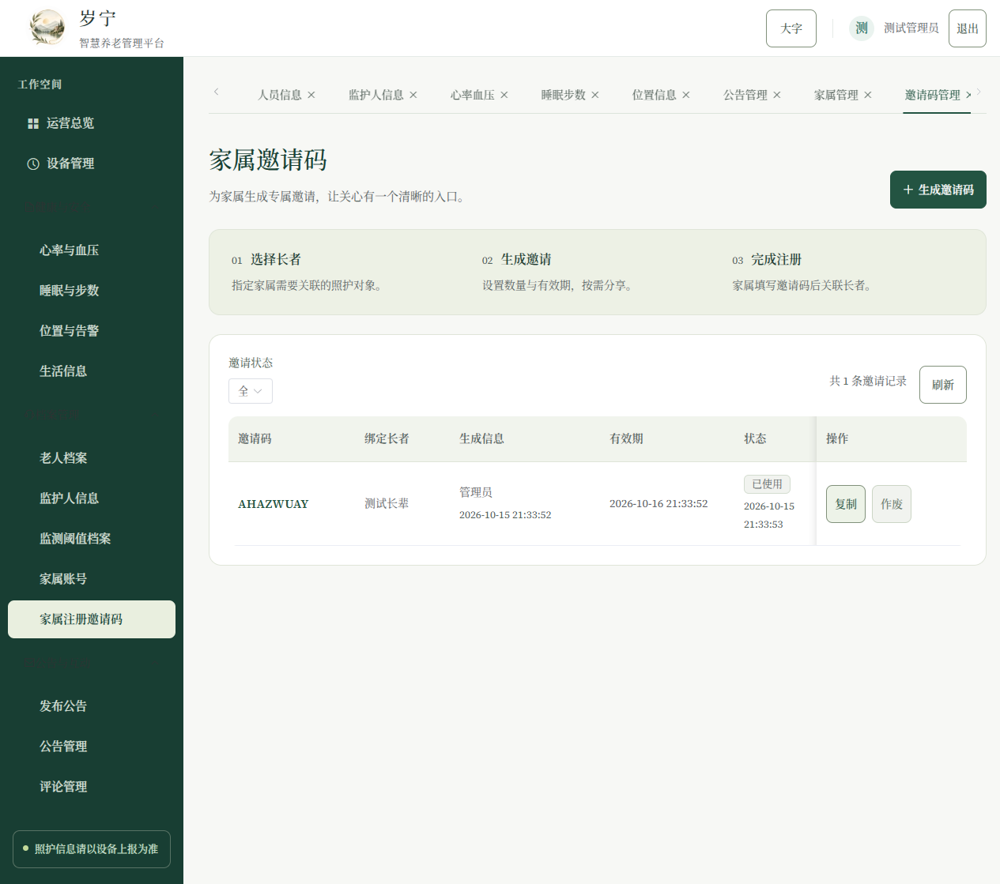

<p align="center"></p>

<h1 align="center">岁宁</h1>
<p align="center">岁月有伴，日常安宁。<br>一款将老人档案、设备记录与家人牵挂放在一起的 Windows 照护软件。</p>

这是 **preview 预览分支**：采用 Vue 3、Vite 8、Spring Boot 3.5 和内置 H2 数据库，提供可直接安装的 Windows 桌面软件。首次使用创建自己的管理员账号，不附带默认手机号、默认密码或样例人员数据。

**[下载 Windows 安装程序](https://github.com/WatchTestCs/smart-elderly-watch-management/releases/tag/v2.0.0-preview.1)** · [项目交接](docs/HANDOFF.md) · [UI/UX 规范](docs/UI_UX.md) · [测试门禁](docs/TESTING.md) · [安全策略](.github/SECURITY.md) · [架构说明](docs/ARCHITECTURE.md) · [使用指南](docs/SETUP.md) · [验收记录](docs/VALIDATION.md)

## 选择适合你的版本

| 版本 | 使用方式 | 适合场景 |
| --- | --- | --- |
| Setup 安装版 | 运行 EXE，按提示安装，再打开桌面快捷方式 | 日常使用，推荐 |
| Portable 免安装版 | 完整解压 ZIP，运行文件夹内的 Suining.exe | 无需安装、迁移程序目录 |
| Source 源码版 | 阅读源码或按构建说明自行打包 | 开发、审查、定制 |

全部文件在 [v2.0.0-preview.1 Releases](https://github.com/WatchTestCs/smart-elderly-watch-management/releases/tag/v2.0.0-preview.1) 中分别附有用途说明。安装版和免安装版均自带 Chromium、Java 21 与文件数据库，**无需另装 Java、Node.js、MySQL、.NET 或 WebView2**。免安装版需要保留整个解压目录，不能只复制 EXE。

面向 Windows 10/11 **x64**。本轮实测 Windows 11；Windows 10 尚未实机验证。此版本为预览发布，实际手表接入仍需设备协议联调。

## 界面预览

截图来自实际界面；账号、公告及健康记录均为验收用测试数据，不代表真实人员或医疗结论。首次安装不会附带这些测试记录。

### 欢迎回来


### 开启照护日常


### 运营总览


<details>
<summary>查看家属窄屏与邀请码管理</summary>

<p></p>



</details>

原有山水 Logo、Source Serif 4 英文与数字字体、中文衬线字体保留。95 个字体文件的摘要核对一致；大字模式、键盘操作和窄屏阅读延续原设计。

## 可以做什么

| 使用者 | 功能 |
| --- | --- |
| 管理员 | 老人档案、监护人、监测阈值、设备登记与绑定、异常处置、家属邀请码、公告发布、评论回复 |
| 家属 | 查看关联长辈的健康记录、睡眠与步数、最近位置、公告，并维护自己的账号资料 |
| 手表设备 | 使用设备号与随机密钥登录、绑定、心跳、上报健康和位置、发送求助或摔倒告警 |

数据以上一次成功上报为准；没有新记录不等于状态正常。界面用于记录与照护协作，不把设备读数直接作为医疗诊断。

## 第一次打开

1. 安装或完整解压软件，打开岁宁。
2. 在“开启照护日常”填写称呼、手机号和密码。**没有默认手机号和密码**；密码为 12–20 位，包含英文字母与数字。
3. 登录后先登记监护人和监测阈值档案，再建立老人档案。
4. 登记并绑定手表，使用设备生成的随机密钥完成接入。
5. 生成家属邀请码，让家属创建与老人关联的账号。

具体步骤、离线使用、备份恢复与联网说明见 [使用指南](docs/SETUP.md)。

## 你的记录保存在这里

默认目录：`%APPDATA%\岁宁`。数据库与上传图片位于用户目录，和程序安装位置分开。

- 升级和卸载保留用户数据，验收中已核对数据文件摘要。
- 备份与恢复前先退出软件，再复制整个数据目录。
- 数据库不依赖外部服务，但本地文件未做磁盘加密，请保管 Windows 用户账户。
- 旧 MySQL 数据不会自动迁入；原始完整 RAR 仍保留在 [历史发布](https://github.com/WatchTestCs/smart-elderly-watch-management/releases/tag/archive-2026-10-13)。

## 技术结构

```text
.
├── docs/                              使用、架构、验收、逐文件介绍与截图
├── 智慧养老手表管理系统/
│   ├── careold/                       Spring Boot 业务、权限与内置数据库
│   ├── oldIot/                        Vue 3 管理端和家属端
│   ├── desktop/                       Electron、固定运行环境、安装与签名
│   └── watch-sim/                     模拟手表请求的联调工具
└── LICENSE                            项目许可
```

| 层次 | 当前方案 |
| --- | --- |
| 界面 | Vue 3.5、Vue Router 4、Element Plus 2.14、Vite 8 |
| 服务 | Spring Boot 3.5、Spring Security、JDBC，Java 17 编译目标 |
| 本机数据 | H2 文件数据库、自动空表初始化、索引与 1–4 连接池 |
| 桌面 | Electron 44、自带 Chromium 和 Temurin Java 21 |
| 打包 | NSIS 3.12 安装程序、独立免安装目录、SHA-256 校验清单 |

旧 Webpack、Babel、node-sass、Vue 2、Vuex、Element UI 框架与外部 MySQL 启动器已退出当前构建。前端锁文件包数从 **1210 降至 137**。后端去掉 MySQL 驱动、旧集合库、短信 SDK 附属依赖与 JUnit 4。

页面和图表按需加载；数据库最新记录查询合并，日记录原子更新，公告图片组用序列分配；短信在事务提交后进入有界队列。按用户要求未运行性能基准，不声明未经测量的加速倍数。详见 [架构与优化](docs/ARCHITECTURE.md)。

## 开发与构建

最终用户不需要开发工具。自行构建需 Node.js 22.12+、Java 17+（推荐 Java 21）、Maven 3.9、Python 3 与 PowerShell 7。

```powershell
cd 智慧养老手表管理系统
./desktop/build.ps1
```

桌面流水线已拆分为 build、package 与 release 阶段：普通 build 只生成未签名应用，不隐式创建签名证书；release 阶段再复制到 signed、签名、生成安装器/Portable ZIP 与 SHA-256/manifest 证据。默认输出为版本化目录 `outputs/v2.0.0-preview/`。首次构建需要网络；完整说明见 [构建指南](docs/BUILD.md) 与 [发布流程](docs/RELEASE.md)。

## 已验证与尚未验证

| 检查 | 结果 |
| --- | --- |
| 后端测试 | 38 项通过，零失败、错误或跳过 |
| 界面检查 | 296 项常规检查 + 10 项首次设置检查通过 |
| 安装后真实程序 | 53 项通过，涵盖设置、建档、模拟上报、权限和重启保留 |
| 安装生命周期 | 安装、覆盖升级、单实例、退出清理、卸载保留数据通过 |
| 前端审计 | 本轮 npm audit 为零已知漏洞，仅代表此次审计范围 |
| 签名 | 应用、安装和卸载程序的加密签名与文件摘要验证通过 |
| 运行环境 | 限制系统工具路径仍可启动，软件资源不依赖外部网页请求 |

没有声称通过 Windows 10 实机验证、真实手表联调、真实短信发送或全产品渗透测试。完整边界与证据摘要见 [验收记录](docs/VALIDATION.md)。

## 关于签名

本轮使用 `CN=Suining Local Build` 自签证书，**并非公开受信任的商业代码签名证书**。Windows 可能仍提示发布者不受信任。安装包不会自动添加系统受信任根，公开 CER 不含私钥。商业公开分发如需受信任发布者，应使用真实代码签名证书重新签署。

发布资产附带 SHA256SUMS.txt，可在 PowerShell 用 `Get-FileHash 文件名 -Algorithm SHA256` 核对下载内容。

## 分支与文件说明

此项目后续操作限定在 **preview**：提交只更新该分支，预发布标签指向该分支的提交。main 与其他分支保持原状。

每个文件都有 [独立用途说明](docs/FILES.md)，同时提供 [机器可读索引](docs/file-descriptions.json)。GitHub 文件列表显示的是最近提交说明，本轮也按文件分别编写提交消息。

## 许可与素材

项目采用 [MIT 许可](LICENSE)。第三方组件沿用各自许可；软件附带 Electron/Chromium 许可、Java legal 目录、字体许可与组件清单。历史原包保持在原有 Release，当前预览源码不包含用户数据库、签名私钥、安装包或构建缓存。

## 待合并的 2026-10-16 修复

[待验收修复清单](docs/PREVIEW_ISSUE_REMEDIATION.md)记录了分页、事务、Flyway 数据迁移、地图与桌面签名改造；[本轮验收数据](docs/preview-remediation-validation.json)区分原工作区报告与远程 CI。**这些修改当前处于草稿 PR 审核阶段，尚未作为新的安装版发布，也不代表全部真实设备测试通过。**
