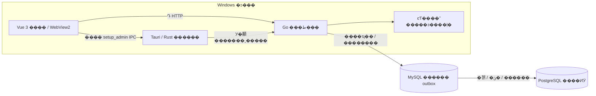

# �����ܹ�����

���Dzֿ��Ŀ¼�ļܹ���ڣ���ϵͳ���˵�������������ļ���;���� [�ļ�����](docs/FILES.md)��

��ǰʵ�֣�**Tauri 2 / Rust + Windows WebView2 + Vue 3 / Vite + Go + MySQL ҵ������ + PostgreSQL ������**�����Ľ�������ֹ����ӿ�·��������Э��͹��ϴ����� [ʵ�ּܹ�](docs/ARCHITECTURE.md)��

PG �ݲ�����ʱ�������ӳ٣��˺š��������豸�ϱ����ջ���������� MySQL����� [˫�ⲿ��������](docs/DUAL_DATABASES.md)��

## ���Ŀ��

���������ܹ������򿪣����ݿ���Ϊ��������ķ�����ڡ����ݿⲻ����ʱ����������ҳȡ������������ֻ������ҵ�����ݵĹ�����ʾ�����á�����ָ����Զ������������õ����ӣ�����ҳ�������룬�����ط�ʧ��д�롣

Windows ����ѽ��桢ԭ������ҵ�����ֿ���Rust �ܴ��ںͽ��̣�Vue �ܽ�����Go ��ҵ�����ݷ��ʡ��������ֱ��������һ���ݿ⣬Ҳ���������ݿ�ƾ�ݻ������ʼ�����ơ�

## ϵͳ��ϵ

���ݿ�����ڱ����������У�Ҳ����λ�ڲ��𷽹����ķ�������Windows Ĭ�� Go �����ػ���̬�˿ڣ����ܰѸö˿�ֱ�ӵ����������ֱ���ڣ���ʵ�豸�����赥�������ܿ����粿��

## �ֲ���Դ��λ��

| �� | ��� | ��Ҫְ�� |
| --- | --- | --- |
| ���� | [desktop](�ǻ������ֱ�����ϵͳ/desktop) | ��ʵ�������ڡ�sidecar ��ϣ��ԭ������������� |
| ���� | [oldIot/src](�ǻ������ֱ�����ϵͳ/oldIot/src) | ҳ�桢·�ɡ�״̬��ʾ��ͼ������� |
| ���� | [backend/cmd/server](�ǻ������ֱ�����ϵͳ/backend/cmd/server) | ��������̨���ӻָ���API ��������̼໤ |
| ҵ�� | [backend/internal](�ǻ������ֱ�����ϵͳ/backend/internal) | ��Ȩ���Ự����������������������ӳ� |
| ���ݱ�� | [migrations](�ǻ������ֱ�����ϵͳ/backend/migrations) | ��Ƕ SQL���汾��¼����ϵԼ�� |
| ���չ��� | [ǰ�� QA](�ǻ������ֱ�����ϵͳ/oldIot/qa) / [watch-sim](�ǻ������ֱ�����ϵͳ/watch-sim) | ����ع����ֱ�Э��ģ�⣬�������ʵ�� |

��ʷ���� `oldIot` �� Go ģ���� `careold-go` ��Ϊ��������Ŀ¼�뵼�룻��ǰԴ�벻ʹ�� Java��Spring Boot��Electron��H2 ��� Webpack ��������

## ���������������

1. Rust У����� Go ���򣬴�������������Ʋ������ӽ��̡�
2. Go �ȼ������ṩ��Ƕ���棬�ٺ�̨���� MySQL��Ǩ�����ǰ���������ݿ�ҵ�� API��
3. Rust ��֤�����ļ��е� PID �Ͷ�̬�˿ڣ��ټ���Ψһ�����ı��� origin��
4. Vue ֱ����ʾ���棬��̨������ݿ�״̬�����Ӳ�����ʱ����ҳ������ʾ����ͨ���ڲ����Կ��á�
5. ���ӻָ�����Ự���ʼ��״̬��Ȩ�޲������߷ſ���ʧ��д�벻�������Զ��С�
6. �����˳�ʱ�� Rust ���� Go ��ȫ�˳�����Ҫʱ��ֹ�ӽ��̣�Go ͬʱ��⸸�����Ƿ���ڡ�

[���ݿ���ϴ���˵��](docs/DATABASE_AVAILABILITY.md) ���ֽ��̴����ݿ�������ѵ�¼�Ự���˳���¼ֻ�������ط���˻Ự����˲�����ҵ�����ݿ⣬����Ҫ��Ự�� CSRF��

## �����밲ȫ�߽�

- MySQL �������ҵ������� outbox��PG ������ؽ��ķ���ͶӰ��Windows ����Ŀ¼����ͼƬ����־�������ļ����Ự���ڴ��С����ݿ���ͼƬ��Ҫ�ֱ𱸷ݡ�
- `setup_admin` �����������������ṩ��Rust �ټ��ʵ��ҳ�� origin����ҳ����ȡ�������ơ�
- ҵ��ӿ��� Go ��ִ�лỰ����ɫ�� CSRF У�飬�豸�ӿ�ʹ���豸��Ȩ��
- MySQL Ǩ��ͨ�����Ӽ�����У���Э����PG ����Ǩ��ʹ������ advisory lock�����Զ�ɾ���������ݡ�
- �� H2 ���ݲ��Զ�ת����ǰ����Դ�� SQL ������ Go ���������ݿ����á�

## ������ƽ̨�߽�

Vue �������� �� Ƕ�� Go ǰ����Դ �� Go ��������� �� sidecar ǩ������ϣ �� Tauri ���� �� NSIS �����Windows Setup ȱʧ WebView2 ʱ������Ĭ��װ��������ʱ���ⰲװ ZIP ʹ��ϵͳ��������ʱ��

Release �� Linux ���������û��ṩ�� Go ��������������������Linux ���ݿ���� DEB ����һ������������� PostgreSQL ���񡣲����� Windows Դ������ս��֤����Щ������ʵ��һ���ԡ�[Linux ˵��](docs/LINUX.md) ������¼�����������ơ�

## �����

[����](docs/BUILD.md) �� [ʹ��](docs/SETUP.md) �� [����](docs/TESTING.md) �� [����](docs/runbooks/backup-restore.md) �� [�ļ�ְ��](docs/FILES.md) �� [ADR-0006](docs/decisions/0006-tauri-go-postgres.md)

����ֻ�޸� `preview`�����ƶ����� Release ��ǩ��Ķ� `main`����ʷ ADR �;����ձ���Ϊ��ʷ���½��۱���ע����Դ��˶ԡ�ģ��ع黹����ʵ������֤��
