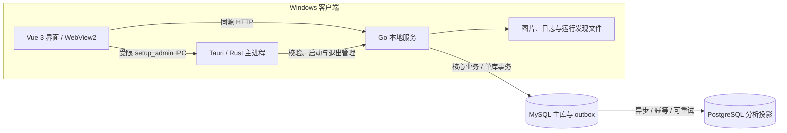

# 岁宁架构总览

当前实现：**Tauri 2 / Rust + Windows WebView2 + Vue 3 / Vite + Go + MySQL 业务主库 + PostgreSQL 分析库**。本文解释整体分工；接口路径、进程协议和故障处理见 [实现架构](docs/ARCHITECTURE.md)。

PG 暂不可用时仅分析延迟；账号、建档、设备上报及照护事务继续走 MySQL。详见 [双库部署与验收](docs/DUAL_DATABASES.md)。

## 设计目标

软件界面能够独立打开，数据库作为单独部署的服务存在。数据库不可用时，不以连接页取代整个软件；只有依赖业务数据的功能提示不可用。网络恢复后自动尝试事先配置的连接，保留页面与输入，但不重放失败写入。

Windows 桌面把界面、原生壳与业务服务分开：Rust 管窗口和进程，Vue 管交互，Go 管业务及数据访问。浏览器不直接连接任一数据库，也不持有数据库凭据或桌面初始化令牌。

## 系统关系

数据库可以在本机独立运行，也可以位于部署方管理的服务器。Windows 默认 Go 监听回环动态端口，不能把该端口直接当作互联网手表入口；真实设备接入需单独安排受控网络部署。

## 分层与源码位置

| 层 | 入口 | 主要职责 |
| --- | --- | --- |
| 桌面 | [desktop](智慧养老手表管理系统/desktop) | 单实例、窗口、sidecar 哈希、原生命令、生命周期 |
| 界面 | [oldIot/src](智慧养老手表管理系统/oldIot/src) | 页面、路由、状态提示、图表与表单 |
| 服务 | [backend/cmd/server](智慧养老手表管理系统/backend/cmd/server) | 监听、后台连接恢复、API 发布与进程监护 |
| 业务 | [backend/internal](智慧养老手表管理系统/backend/internal) | 鉴权、会话、请求防护、处理器与连接池 |
| 数据变更 | [migrations](智慧养老手表管理系统/backend/migrations) | 内嵌 SQL、版本记录、关系约束 |
| 验收工具 | [前端 QA](智慧养老手表管理系统/oldIot/qa) / [watch-sim](智慧养老手表管理系统/watch-sim) | 界面回归与手表协议模拟，不能替代实机 |

历史名称 `oldIot` 和 Go 模块名 `careold-go` 仅为兼容现有目录与导入；当前源码不使用 Java、Spring Boot、Electron、H2 或旧 Webpack 构建链。

## 生命周期与可用性

1. Rust 校验随包 Go 程序，创建随机桌面令牌并启动子进程。
2. Go 先监听并提供内嵌界面，再后台连接 MySQL；迁移完成前不发布数据库业务 API。
3. Rust 验证就绪文件中的 PID 和动态端口，再加载唯一允许的本机 origin。
4. Vue 直接显示界面，后台检查数据库状态；连接不可用时仅在页面内提示，普通窗口操作仍可用。
5. 连接恢复后检查会话与初始化状态。权限不因离线放宽，失败写入不进入重试队列。
6. 窗口退出时由 Rust 请求 Go 安全退出，必要时终止子进程；Go 同时监测父进程是否存在。

[数据库故障处理历史记录](docs/DATABASE_AVAILABILITY.md) 主要对应旧版 PG 单库与内存会话。当前退出登录仍须通过会话与 CSRF 校验；默认数据库会话的服务端撤销依赖 MySQL，主库断开时可能返回 503，不能将浏览器清除 Cookie 等同于服务端撤销成功。

## 数据与安全边界

- MySQL 保存核心业务、加密数据库会话和分析 outbox，PG 保存可重建的分析投影；Windows 本地目录保存图片、日志与运行文件。只有显式启用单实例开发选项 `SESSION_BACKEND=memory` 才把会话保存在 Go 进程内存。数据库与图片需要分别备份。
- `setup_admin` 仅向允许的主窗口提供，Rust 再检查实际页面 origin；网页不获取桌面令牌。
- 业务接口在 Go 中执行会话、角色与 CSRF 校验，设备接口使用设备鉴权。
- MySQL 迁移通过连接级锁与校验和协调，PG 分析迁移使用事务及 advisory lock；不自动删除遗留数据。
- 旧 H2 数据不自动转换，前端资源与 SQL 被编入 Go 不等于数据库内置。

## 构建与平台边界

Vue 生产构建 → 嵌入 Go 前端资源 → Go 测试与编译 → sidecar 签名及哈希 → Tauri 编译 → NSIS 打包。Windows Setup 缺失 WebView2 时联网静默补装共享运行时，免安装 ZIP 使用系统已有运行时。

Release 的 Linux 软件包是用户提供的 Go 服务配合浏览器启动包；Linux 数据库管理 DEB 是另一个组件，不包含 PostgreSQL 服务。不能用 Windows 源码或验收结果证明这些附件的实现一致性。[Linux 说明](docs/LINUX.md) 单独记录其依赖和限制。

## 维护入口

[构建](docs/BUILD.md) · [使用](docs/SETUP.md) · [测试](docs/TESTING.md) · [备份](docs/runbooks/backup-restore.md) · [文件职责](docs/FILES.md) · [ADR-0006](docs/decisions/0006-tauri-go-postgres.md)

本轮只修改 `preview`，不移动既有 Release 标签或改动 `main`。历史 ADR 和旧验收保留为历史；新结论必须注明是源码核对、模拟回归还是真实运行验证。
