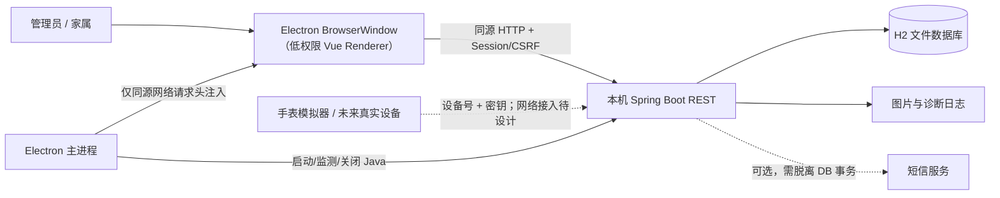

# 岁宁（Suining）· 开发架构总纲

> **适用范围**：`WatchTestCs/smart-elderly-watch-management` 的 `preview` 分支；不自动适用于 `main`。  
> **校准日期**：2026-10-16（依据本分支仓库文件审阅，不代表所有运行时行为已经实测）。  
> **定位**：面向研发、评审、维护、AI 辅助开发和交接的**架构入口与变更约束**。  
> **状态说明**：本文用 **[现状]** 描述仓库已有实现，用 **[必须]** 约束新变更，用 **[待建设]** 标注尚未证明或尚未落地的目标。不得将“应当”写成“已经实现”。

## 0. 使用本文件的方式

每次开始任务，按顺序完成：**确认分支和基线 → 确认用户任务、影响面与数据敏感度 → 阅读对应契约 → 设计最小修改 → 补测试 → 实现 → 验证 → 更新文档/证据**。发生冲突时不得任选一个说法：先核对实际代码和测试，再修正失效文档；如果触及已接受 ADR 或安全不变量，暂停直接修改并走架构评审。

| 要解决的问题 | 应阅读的权威材料 |
| --- | --- |
| 系统当前怎样组成、进程/信任边界 | [docs/ARCHITECTURE.md](docs/ARCHITECTURE.md) |
| 为什么采用某项不可轻易逆转的方案 | [docs/decisions/](docs/decisions/README.md)（ADR） |
| 开发环境、编译和桌面构建 | [docs/BUILD.md](docs/BUILD.md) |
| 产品操作和用户数据位置 | [docs/SETUP.md](docs/SETUP.md) |
| UI/UX、视觉、响应式、可访问性 | [docs/UI_UX.md](docs/UI_UX.md) |
| 测试门槛及哪些结果真正自动化 | [docs/TESTING.md](docs/TESTING.md) |
| 交接、排障入口和工作流 | [docs/HANDOFF.md](docs/HANDOFF.md) |
| 发版、签名、回滚、备份 | [docs/RELEASE.md](docs/RELEASE.md)、[docs/runbooks/](docs/runbooks/) |
| 已有一次性验收、局限及证据 | [docs/VALIDATION.md](docs/VALIDATION.md) |
| 漏洞报告方式 | [.github/SECURITY.md](.github/SECURITY.md) |
| 文件用途索引 | [docs/FILES.md](docs/FILES.md) |

**文档职责与防漂移规则**：本文件定义“开发时必须守住什么、如何证明改动正确”；`docs/ARCHITECTURE.md` 记录更详细的*当前结构*；ADR 记录决策背景、备选方案与后果；UI、测试、发布专题文件定义各自可操作的检查项。不要在多份文档维护彼此独立的版本数字、测试通过次数或发布承诺；变更相关规则时联动更新，禁止只修改一处导致事实冲突。

## 1. 目标、非目标和可靠性语义

**[现状]** 岁宁是**本机优先**的 Windows 照护桌面应用，服务老人档案、监护/家属关系、手表接入、健康与位置记录、异常处置和公告协作。当前交付面向 Windows 10/11 x64，公开验收主要来自 Windows 11。默认后端及数据在本机，不依赖外部 MySQL。

**[必须]** 任何安全或 UX 设计优先保证：**数据不丢失、权限不越界、告警不被误判、故障可识别可恢复、版本可回滚且证据可追踪**。尤其要区分：
- `正常`：有明确、足够新的记录支持该状态；
- `异常`：规则或上报指出异常，需显示依据及时间；
- `未知/离线`：数据缺失、过期、设备未连接或接入失败，**不等同于正常**；
- `已处置`：有人执行了明确处置动作，不等于异常在医学意义上已消失。

**[非目标/限制]** 当前不是经临床验证的诊断系统，也不是保证可用的急救调度系统；不能把手表数据写成医疗结论。真实手表端到端接入、真实短信、Windows 10 实机、正式性能基准和独立渗透测试目前不能宣称通过。

## 2. 系统结构（仓库代码校准）



| 容器/职责 | 现有路径 | 技术与边界 |
| --- | --- | --- |
| Electron Main / 安装发布 | `智慧养老手表管理系统/desktop/` | Electron 44；`main.cjs` 管进程、窗口、完整性、桌面令牌；`build.ps1` / `package.ps1` / `release.ps1` 分阶段交付 |
| Vue Renderer | `智慧养老手表管理系统/oldIot/` | Vue 3.5、Vue Router 4、Element Plus 2.14、ECharts 6、Vite 8；Hash 路由，管理员/家属 UI |
| Java REST 服务 | `智慧养老手表管理系统/careold/` | Spring Boot 3.5、Spring Security、JDBC、Hikari；Java 17 编译目标，随包 Temurin Java 21 |
| 数据 | `careold/src/main/resources/schema.sql` | H2 file、图片目录、日志；H2 连接池最小空闲 1、最大 4 |
| 模拟联调 | `智慧养老手表管理系统/watch-sim/` | 模拟设备协议请求；配置中的 `127.0.0.1:8795` 是**开发端口**，非安装版固定端口 |
| 自动化 | `.github/workflows/`、`tests/ui/` | 后端测试、前端构建、UI 基线、静态安全、桌面契约、候选包 |

### 2.1 当前关键模块映射

- **前端入口**：`src/main.js`、`src/router.js`、`src/auth.js`；`views/` 为业务页，`components/` 为共享 UI；`assets/css/tokens.css` → `element-theme.css` / `accessibility.css` → `commercial.css` 为逐步收敛的视觉层。
- **服务入口与边界**：`CareoldApplication.java`、`security/SecurityConfig.java`、`security/AccountAccess.java`、`controller/`、`dao/`、`domain/`、`config/DesktopReady.java`。
- **核心域**：管理员/家属身份与关联老人；老人/监护人档案；设备身份、绑定码与状态；生命体征和日步数；位置；SOS/摔倒/异常处置；邀请码；公告/图片/评论。
- **桌面**：`main.cjs` 保持最高权限；`prepare-package.cjs` 固定 ASAR/fuses 和受保护组件摘要；`runtime-lock.json` 锁定运行时版本与校验值；`version.json` 为版本源。

**[现状与演进方向]** 后端仍存在 Controller 直接承担较多业务编排并调用 DAO、大型 `DeviceController.java` / `DeviceJdbcDao.java` 和前端大型 SFC。**[待建设]** 在测试锁定行为后逐域引入薄 Controller、明确 Application Service、事务/授权边界与职责清晰的 Repository/DAO。禁止先搭一套空的“整洁架构”再强行迁移所有业务。

## 3. 关键数据流与失败契约

| 流程 | 责任边界 | 关键不变量/反例 |
| --- | --- | --- |
| 桌面启动 | Electron 校验关键资源 → 启动随包 Java → 等待携带 PID/端口的就绪文件 → 加载本机 Origin | 默认 loopback、端口由服务选择；不得依赖固定端口、任意网页或提前开放窗口 |
| 首次设置 | Renderer 提交表单 → Electron 同源请求注入 `X-Suining-Desktop` → Spring 校验令牌及 CSRF → DB 行锁保证唯一初始化 | 不提供默认账号；并发初始化只能成功一次；不能把桌面令牌交给 Renderer JS |
| 登录/授权 | `GET /restful/userLogin/session` 获取 CSRF/会话信息 → 登录后由 Spring 写服务端 Session、轮换会话及 CSRF | 角色/对象归属由服务端决定；前端路由只是 UX 导航，不是权限控制 |
| 家属访问 | 服务器先校验已登录角色，再核对请求对象对当前家属的归属关系 | 不能信任前端传入的 `oldId` / `familyId` / 手机号；解绑后旧会话不可继续读他人数据 |
| 手表接入 | `/restful/device/login|bind|heartbeat|report|sos`；设备号、密钥、绑定码与业务写入 | 设备接口虽在 Spring 授权规则中公开，却必须按设备身份认证、重放/并发/时间戳风险独立审查；“公开接口”不等于“无需认证” |
| 告警 | 接收/规则判断 → 持久化告警 → 展示状态与上报时间 → 由授权人员处置 | 不能用空数据推导健康正常；“已读/已处置/已恢复”应有独立可验证语义 |
| 图片/公告 | 输入校验 → 受控文件写入 → DB 引用关系 → 角色约束的读取 | 防路径穿越、危险格式与超额大小；跨文件/数据库失败须有补偿或清理 |
| 备份/升级 | 完整退出服务 → 备份数据库与图片 → 独立验证恢复；发布改变二进制不改写用户目录 | 不能静默清库、覆盖旧数据、只备份单个表或把测试库当作用户库 |

**[必须]** API 失败先区分 **传输错误 / 401 未认证 / 403 或 CSRF / 429 限流 / 业务失败 / 数据缺失 / 超时**。本项目保留 `returnCode`（常见成功 `1111`）等旧响应字段；不要把 HTTP 200 与业务成功混为一谈，也不能用统一 toast 抹掉不同错误语义。写请求失败不可未经幂等设计直接自动重放；CSRF 失效可刷新令牌，但不可自动重放原写操作。

## 4. 不允许静默破坏的架构不变量（P0）

1. **信任边界**：Renderer 不获得 Node.js、任意文件、任意进程及任意 IPC 能力；`nodeIntegration=false`、`contextIsolation=true`、`sandbox=true`、`webSecurity=true`；导航、新窗口、WebView、下载、权限申请默认拒绝。
2. **最小网络暴露**：本机服务默认监听 `127.0.0.1`，生产桌面不得为接入手表而简单暴露到 `0.0.0.0` 或打开 CORS。**[已知风险]** 当前 `main.cjs` 保留 `SUINING_BIND_ADDRESS=0.0.0.0` 环境变量分支；这不是对公网/LAN 安全部署的支持声明。启用前必须另行完成威胁建模、ADR、认证/传输/防重放设计与测试。
3. **身份分层**：桌面随机 token 只标识受控桌面网络路径，**不是**管理员、家属、设备的授权凭据，也不能替代对象级授权；Renderer 发往本机 Origin 的请求可以被网络层注入 token，因而 token 不能抵御已被攻陷的 Renderer。
4. **服务端认证授权**：默认拒绝未知接口；管理员与家属最小权限，按对象与字段检查；Session cookie HttpOnly、CSRF 对需要的写操作保持有效；设备专用端点必须验证设备号/密钥和业务状态。
5. **本机数据所有权**：数据库、图片、日志存于 Electron `userData`（Windows 默认 `%APPDATA%\岁宁`），非安装目录；升级、安装、卸载默认不得删除用户数据；测试绝不使用真实数据目录。
6. **持久化与一致性**：多表状态转换有原子边界；查询不偷偷写入；网络/SMS 不在 DB 锁内等待；文件与数据库各自成功不等于整体交付成功。
7. **安全语义**：告警不可静默丢弃或伪装正常；设备掉线、超时、缺测及数据过期独立呈现；健康 UI 不作无依据医学诊断。
8. **可追溯交付**：版本、源码 SHA、构建、测试、签名、校验和必须关联；普通 CI 不接触签名私钥；禁止未验证的“性能提升”“全面安全”“支持真实设备”宣传。
9. **回归证据**：任何更改此清单的提案都属于架构变更：先写 ADR（包含威胁、备选方案、迁移与回滚）、补可失败的测试，再批准实现。不能靠改文档删掉检查。

## 5. 分层依赖、接口与代码质量

**[必须]**
- **依赖方向**：View/Component → 前端 API/状态管理 → HTTP → Controller → 业务应用逻辑 → DAO → H2；Electron Main 只管理系统能力及启动生命周期，不复制业务数据/授权规则。不同业务域通过明确接口协作，不互相直接修改存储内部结构。
- **职责单一**：新逻辑优先放到有名字、可独立测试的函数/服务。Controller 做入参校验、权限上下文、协议转换；业务层承载用例、状态机和事务；DAO 实现查询/持久化。大型旧类遵循“小步替换 + 契约测试 + 可回滚”，不以文件行数为唯一重构指标。
- **前端的数据唯一来源**：接口响应/会话为事实源。`localStorage` 里的用户展示信息不可作为授权来源；组件不随意直接操作跨页全局状态；禁止以静态假数据掩盖真实 API 故障。
- **API 契约**：记录 method/path、角色、对象归属、字段类型及范围、错误码、幂等性、时间字段的时区/单位；新增接口应有成功/失败示例和安全测试。可增量治理旧 `LinkedHashMap`，不需一次性破坏现有调用。
- **输入与输出**：所有外部值视为不可信；分页/范围查询有上限；SQL 使用参数绑定；路径、文件名、MIME 和实际文件内容经过校验；不在日志/错误消息回显凭据或健康明细。
- **并发与时间**：数据库生成的唯一标识/索引优于“先查询再插入”；状态推进使用原子更新或受控锁；明确 `eventTime` 与 `receivedAt`、UTC/本地显示、迟到上报、重复上报和跨日边界；网络失败不允许改变已经确认的告警/处置。
- **兼容性**：保持既有返回字段、设备请求与数据库读取兼容；破坏性变化应有版本标识、迁移路径、回退限制和消费者测试。
- **代码审查**：减少隐式全局变量、重复常量、共享可变状态与宽泛 catch；禁止“catch 后返回成功”、吞异常、用固定 sleep 修复竞态。引入依赖必须说明必要性、体积、安全维护及锁文件变化。

## 6. 数据、迁移、备份和个人隐私

**[现状]** `schema.sql` 在启动时执行幂等 `CREATE TABLE/ALTER ... IF NOT EXISTS`，`app_metadata` 存在 `schema_version`；这**不等价于**已有完善的版本化迁移引擎。数据库为 H2 文件，配置使用 MySQL 兼容模式；本地 H2 文件和图片未由应用自身提供静态加密保证，Windows 用户账户和磁盘保护仍是现实安全边界。

**[必须]**：
1. **修改表结构前**：建立真实旧版本匿名化 fixture；先备份并验证可恢复；写出 `N → N+1` 的显式、可重复、可检查迁移与中断后恢复设计；验证空库、旧库、部分失败及重复执行。不能以“重装会重建表”替代迁移。
2. **数据完整性**：外键或应用层关联策略必须清楚；唯一约束、必填性与业务不变量要测试；有图片引用的流程考虑暂存、事务提交后发布、失败清理与孤儿回收；不允许删除仍被引用的文件。
3. **备份/恢复**：遵守 [runbook](docs/runbooks/backup-restore.md)；完全关闭 Java/H2 后复制整个数据目录，在**隔离数据目录**做一次恢复启动、表/图片/关联核验；恢复失败不得清理原库。
4. **隐私最小化**：老人、健康、位置、联系电话、设备标识等按敏感数据处理；只展示任务所需字段；日志、测试 fixture、截图、CI artifact、报错、Issue、PR 不得包含真实个人记录或密钥；设置合理的访问、保留、导出/删除授权策略前不对外宣称符合法规认证。
5. **凭据**：用户密码须使用安全密码散列；设备密钥只在必要的注册/轮换流程受控出现；生产密钥不能提交仓库、放进可公开下载的包或普通日志。设备密钥目前位于本地数据库字段，应纳入静态数据泄露威胁分析。
6. **数据库能力限制**：单机 H2 不代表多人远程协作或多实例写入能力；任何同步/云化/多机数据库方案必须独立 ADR 和迁移验证，不得简单替换 JDBC URL。

## 7. 安全威胁建模与审核重点

每个高风险 PR 填写一个最小威胁表：**资产 → 攻击者能力/入口 → 信任边界 → 误用方式 → 控制措施 → 自动证据 → 剩余风险**。按至少以下威胁检查：
- Renderer XSS/不可信内容：富文本公告、上传图片、动态 HTML、URL 导航；检查转义、CSP、隔离和有无越权调用。
- 权限提升/水平越权：伪造 `oldId`、手机号、家属 ID、设备 ID、上传图片归属；必须有跨账号负例。
- 公共入口滥用：邀请码探测、登录暴力尝试、设备密钥猜测/重放、SOS 伪造、请求洪泛；检查速率、撤销、失效、幂等及审计。
- 本机攻击面：恶意本地进程、环境变量、loopback 访问、服务启动时序、被替换运行时、包含隐私的崩溃日志；注意“仅本机监听”不意味着“仅本应用能访问”。
- 供应链：npm/Maven/运行时/NSIS 版本固定、摘要核验、第三方许可、SBOM、签名私钥隔离；不能因构建失败移除校验。

可参考 [OWASP ASVS 5](https://owasp.org/www-project-application-security-verification-standard/) 建立逐条安全需求映射；**引用标准不代表已经通过 ASVS 认证或测试**。安全问题按 [SECURITY.md](.github/SECURITY.md) 私密报告，禁止公开漏洞细节与真实凭据。

## 8. UI/UX 作为工程契约

**[必须]** 保持现有“岁宁”品牌和稳定设计基线，除非任务明确要求并经视觉验收。视觉设计不是单纯调色；必须先梳理用户、目标任务、信息优先级、页面状态，再讨论排版、色彩、字体、组件和动效。
- **可读可操作**：默认正文沿用至少 16px 基线；重要目标 ≥48×48px，辅助可交互目标 ≥44×44px；键盘焦点可见；主要操作有可访问名称；颜色不作为唯一反馈。
- **响应式**：至少审视 1360×900 主桌面、1024×768 紧凑桌面、390×844 家属窄屏、360×560 最小窗口，以及桌面/窄屏大字模式；窄屏应重排信息而非挤压成小表格。
- **状态全覆盖**：loading / empty / error / normal / long-content / destructive confirmation / offline / stale data；错误不应被吞并成空态，删除/解绑要明确对象、影响和可恢复性。
- **交互与动效**：焦点进入/恢复、键盘路径、滚动及对话框关闭、禁用与等待状态、重复提交、`prefers-reduced-motion`；触屏误触与紧急情况下的可用性优先。
- **视觉资产**：共享颜色、字体、间距、圆角、阴影和状态语义优先放 design tokens；统一组件优于页面层层覆盖 CSS。现有 `commercial.css` 分阶段瘦身，禁止无回归覆盖的“一键重画全部 UI”。
- **数据呈现**：生命体征显示值、单位、采样时间、来源和新鲜度；位置提供时间和状态，告警显示优先级、处置状态与下一步。

UI 工作流：**现状截图与任务流 → 问题/严重度 → 设计方案及保留项 → token/组件 → 页面实现 → 交互/a11y 检查 → 视觉前后对比 → 审核确认**。详见 [UI_UX.md](docs/UI_UX.md)。AI 可用于生成审美方案、组件代码、测试用例和评审清单，但**AI 生成物属于未验证输入**：不能未经人工审查、真实浏览器截图和业务测试直接替换当前视觉基线。

## 9. 质量策略：明确现有门禁与未来目标

| 验证层 | 已有可重复入口 | 新变更必须补充什么 |
| --- | --- | --- |
| 前端安装/构建 | `.github/workflows/ci.yml` → `reusable-frontend.yml` | 改 UI/逻辑时运行生产构建，并补交互/状态测试 |
| 后端安全/逻辑/DB | `reusable-backend.yml`，`mvn clean verify` | 受影响的权限、事务、失败、并发和真实 H2 测试 |
| UI/a11y/视觉 | `.github/workflows/ui-quality.yml`、`tests/ui/ui-smoke.mjs` | 该工作流目前重点是登录页桌面/移动端/大字与粗粒度视觉基线；新增业务页不能假定已有 E2E |
| 静态安全 | `.github/workflows/security.yml` | CodeQL、PR dependency review；加敏感接口还需针对性安全测试 |
| 桌面脚本契约 | `.github/workflows/desktop-contract.yml` | 版本一致、脚本语法、构建脚本约束；**不等同真实安装验收** |
| 候选交付 | `preview-candidate.yml`、`docs/RELEASE.md` | 真实 Windows 启动、首次设置、登录、模拟上报、退出、升级、卸载、checksum / SBOM / attestation |

**[必须]** 检查 workflow 的 `paths`、`if` 和事件类型。某项检查**没有触发**≠通过。`docs/VALIDATION.md` 2026-10-15 的数量和结果属于历史实测，不得自动当作新 commit 已通过。

仓库根目录示例（PowerShell；先安装 Node.js 22.12+、Java 17+/推荐 21、Maven 3.9）：

```powershell
cd 智慧养老手表管理系统/oldIot
npm ci
npm run build
npm audit --omit=dev --audit-level=high
cd ../..
mvn -Dnet.bytebuddy.experimental=true -f 智慧养老手表管理系统/careold/pom.xml clean verify
```

Windows 桌面完整构建（另需 Python 3、PowerShell 7、下载构建工具；从仓库根目录执行）：

```powershell
cd 智慧养老手表管理系统
./desktop/build.ps1
./desktop/package.ps1
# 仅在受控 release 流程：
./desktop/release.ps1 -SkipBuild
```

测试设计至少覆盖：**正向/拒绝、空库/旧库、正常/异常、超时/重试、并发/重复提交、卸权后旧会话、跨账户访问、持久化重启、破坏性操作恢复**。资源泄漏、降级、长列表和大字体问题不能只靠单元测试发现。不要修改断言来适配错误实现，不要用 mock 代替全部真实数据库/文件系统测试。

## 10. 性能、资源与可观测性

- **[必须] 先测再优化**：报告硬件/OS、版本 SHA、样本量、冷/热启动、数据规模、p50/p95/最差值、CPU、内存、IO、界面响应、测试脚本。当前没有正式性能基线，不得编造“提升百分比”。
- 优先排查首屏 bundle、昂贵图表、大表格/DOM、重复 API、N+1、无索引“最新记录”查询、长事务、数据库连接耗尽、批量导入与图片尺寸。分页/缓存必须保持权限及数据新鲜度。
- 数据库连接池当前上限为 4；对并发、索引、查询计划和写入冲突使用可复现负载评估。不得仅靠加大连接池掩盖锁或慢 SQL。
- 日志分类：启动/进程、身份/权限（脱敏）、业务状态、告警、文件读写、发布与异常。加时间、操作类型、匿名关联 ID 和结果，但不要记录明文令牌、密钥、密码、完整健康/位置个人数据。
- 突发错误应被看见且可定位：状态码/错误码/可恢复提示/日志线索相互对应；不可对用户展示堆栈或把错误静默改为“0 条”。

## 11. 开发、评审与 AI 协作标准流程

1. **读取任务**：写一句可测试的用户结果、范围、明确不改的部分；确认 `preview` HEAD 与工作树；不要顺手修改 `main`。
2. **影响分析**：列文件/模块、API、角色与对象归属、数据库/磁盘、启动/打包、UI 状态、依赖、兼容性、风险等级；必要时画请求/写入序列。
3. **选择最小方案**：比较至少“沿用现有结构”和“提炼边界后的方案”，指出权衡；复杂或难回退的跨模块决策写 ADR。
4. **验收先行**：增加会在旧代码/错误修复上失败的契约/回归测试；准备去标识化 fixture、异常和恢复案例。
5. **实现**：先保证端到端闭环，再渐进抽象；限制 PR 范围；UI 视觉变更与行为重构尽量分 PR。
6. **验证**：运行与影响匹配的 workflow/本地测试；检查截图、响应错误、持久化和权限；标注没有执行的项目，避免“全绿”假象。
7. **审查**：检查越权、数据丢失、安全配置、非预期文件、私密信息、日志、性能退化、操作系统差异；PR 描述含 before/after、失败注入、证据链接。
8. **提交/交接**：描述为何改变、风险、手动复核、迁移/回滚；更新对应专题文档与 ADR；记录未解决风险及负责人，而不是让下个维护者猜测。

**PR 最小证据模板**（按影响填，不需要机械照搬）：

```text
目标/问题：
现状依据（文件/代码路径/复现步骤）：
拟改边界与不变量：
备选方案及不采用原因：
兼容性/迁移/回滚：
测试：命令、结果、环境、commit、截图/日志链接：
未覆盖与风险：
文档/ADR 更新：
```

**变更级别**：
- **普通**：局部样式/文案/重构，行为与契约不变；适配的自动检查即可。
- **敏感**：角色授权、个人数据、设备、告警、写入事务、图片、跨页状态；必须对应边界负例与失效/恢复测试。
- **架构级**：信任边界、服务暴露、数据格式或持久化策略、构建签名、公开设备接入、多机/云化；必须 ADR、威胁模型、迁移/回滚与维护者审查。

**AI 使用规约**：AI 必须基于**当前 `preview` 的真实文件**作答；指出证据来源；不得捏造执行结果、API、测试通过、依赖版本或安全认证。不能因为生成代码编译成功便宣称功能可用。代码生成后仍由维护者承担安全、审美、许可、回归验证责任；禁止将用户数据、私钥、设备密钥、短信凭据提供给不受控模型或粘贴到 issue。

## 12. 发布、故障与回滚

- 版本由 `desktop/version.json` 定义，前端 `package.json`、后端 `pom.xml` 与之保持一致；发布标签指向唯一 `preview` commit。
- **Build → Package → Sign/Release** 分开执行；Candidate 可以未签名，不能当成用户受信任发布；普通 PR CI 无私钥。
- 发布前检查 Windows 安装、完整解压 Portable、离线/首次设置、角色隔离、模拟设备上报、单实例、退出 Java、重启数据保留、升级/卸载保留数据及 SHA-256。
- 自签名 `CN=Suining Local Build` 只证明签名存在，不能声称 Windows 公共信任；正式公开分发的代码签名、SBOM、来源证明按 [RELEASE.md](docs/RELEASE.md) 单独管理。
- 生产故障按 **保护原始数据 → 记录版本/环境 → 复现或隔离 → 界定影响 → 恢复验证 → 根因分析/回归测试** 处理；数据库损坏不得自动清库。
- 回滚应用前确认新旧数据库兼容性。不能假设“替换旧 EXE”就能回滚 schema；有破坏性迁移必须提供恢复备份和明确版本限制。参见 [rollback runbook](docs/runbooks/rollback.md)。

## 13. 当前已知风险与治理次序（不冒充已完成）

| 优先级 | 已知事实/缺口 | 下一步验收条件 |
| --- | --- | --- |
| P0 | `SUINING_BIND_ADDRESS` 可显式开启 `0.0.0.0`；真实设备默认无法经 loopback 从外部连接 | 明确限制生产联网暴露；真实设备接入先做独立网络架构/认证/加密/抗重放 ADR 及测试 |
| P0 | 健康/位置等敏感数据在本地 H2 与图片目录；未建立应用层静态加密保证 | 做数据风险分级、文件/磁盘保护与备份保护设计；验证日志、导出、恢复及设备秘密暴露面 |
| P1 | `schema.sql` 幂等建表不是版本化迁移框架；存在跨版本数据演化风险 | 引入可校验版本迁移、旧库 fixture、备份恢复和失败中断回归；不得盲改已发布表 |
| P1 | 真实手表、真实短信、Windows 10、完整性能与渗透测试尚无闭环证据 | 各自建立实物/环境测试计划与可复验记录；保持发布声明诚实 |
| P1 | UI 自动化以登录页为主，大型 SFC、集中 CSS 和部分后端大类尚在 | 按“登录→建档→绑定→健康→告警→家属→备份/恢复”补测试后分批解耦 |
| P1 | 文件/DB 原子一致性、重复上报、断电与外部调用失败需要更系统的失效注入 | 在关键写流程增加冲突/断电/幂等/引用一致性测试及清理机制 |
| P2 | 公开使用说明中的密码长度与 `SetupController` 的服务端字节长度校验表述不完全一致 | 统一 UI、后端、README 与边界值测试，防止误导用户 |

优先次序依据：**不可逆损失/越权 > 安全错误和错误健康语义 > 可恢复性与兼容 > 流程完整度 > 性能 > 装饰性优化**。表中是开发/验收任务，不是未经检查即可改动生产代码的授权。

## 14. 决策与文档维护协议

重大改变以 `docs/decisions/NNNN-short-title.md` 新建 ADR，不重写历史结论；至少包含：

```text
Title / Status（Proposed | Accepted | Superseded）/ Date
Context：用户目标、实际约束、原始证据
Decision：明确做什么、信任/模块边界、数据/API 影响
Alternatives：至少一个可行备选及否决理由
Consequences：好处、代价、失败模式、运维和安全影响
Migration / rollback：兼容路径与回退条件
Verification：自动测试、人工验证、尚未证明的结论
```

更新触发：
- 改用户场景、模块/数据流 → 更新本文件与 `docs/ARCHITECTURE.md`；
- 改安全/持久化/发布决策 → 新 ADR + 测试；
- 改视觉 token / 交互 / 断点 → `docs/UI_UX.md` 和基线证据；
- 改构建/依赖/门禁 → `docs/BUILD.md`、`docs/TESTING.md`、workflow；
- 改产品交付/支持边界 → `README.md`、`docs/RELEASE.md` 与手动验收；
- 改保留/恢复策略 → runbook 和恢复演练。

**文档的验证标准**：链接有效、路径真实、命令可运行、版本一致，图与代码对应；结论显式标记“已实现/计划中/尚未验证”。不把本文件当成一次性说明：每次跨边界 PR 都要审查是否导致它过期。

## 15. Definition of Done（完成定义）

只有同时满足以下适用条件，任务才能标记完成：

- [ ] 目标、范围、风险、受影响模块和不可更改的行为有说明；
- [ ] 实现不突破 P0 信任/权限/数据/告警不变量；
- [ ] 权限、失败、并发、持久化与兼容性按影响新增或复用测试；
- [ ] 生产构建及所有**实际应触发**的检查通过；没有触发的检查明确标注；
- [ ] UI 改动完成真实窗口、窄屏、大字、键盘、关键页面状态及视觉比对；
- [ ] 不包含真实用户数据、日志秘密、私钥和可复现的敏感凭据；
- [ ] 涉及 DB/桌面/发布时完成备份、恢复、安装升级及回滚风险审查；
- [ ] 更新实际受影响的 API/架构/ADR/UI/测试/发布文档；
- [ ] PR 提供重现步骤、commit 和证据，并写明仍未验证什么；
- [ ] 发布候选单独通过安装态及端到端验收，不以编译成功代替。

---

### 方法与参考

结构视图采用 [C4 模型](https://c4model.com/diagrams) 的上下文/容器抽象；安全审核可参考 [OWASP ASVS](https://owasp.org/www-project-application-security-verification-standard/)；交互与可访问性参考 [WCAG 2.2](https://www.w3.org/TR/WCAG22/)；本项目额外设定更大的 44/48px 可交互目标。**参考行业标准不等于本项目已完成符合性认证**。本文件首先服从此仓库 `preview` 的真实证据、已接受 ADR 和回归测试。
