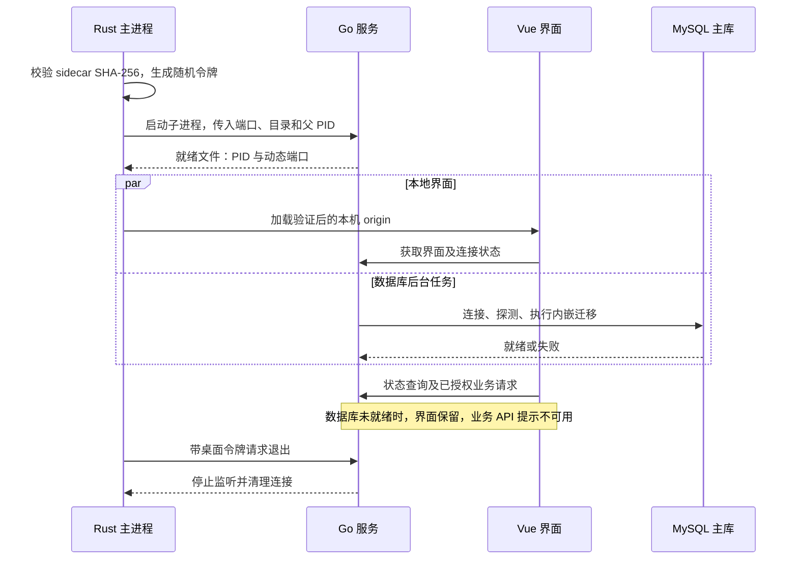
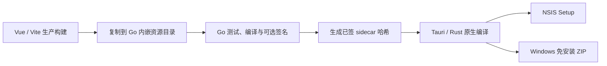

# 实现架构 · Tauri / Go / Vue / MySQL / PostgreSQL

本文与当前 `preview` 源码对应，解释实际进程、协议、数据和构建路径。产品入口见 [README](../README.md)，整体关系见 [架构总览](architecture/overview.md)，取代旧桌面设计的决定见 [ADR-0006](decisions/0006-tauri-go-postgres.md)。

当前本地补丁采用 **MySQL 业务主库 + PG 异步分析库**。下述进程和鉴权边界保留，旧 PG 单库迁移描述属于兼容历史；当前双库职责、配置及恢复流程以 [DUAL_DATABASES](DUAL_DATABASES.md) 为准。

## 组件职责

| 组件 | 实现 | 负责 | 不负责 |
| --- | --- | --- | --- |
| 原生桌面 | Tauri 2 / Rust / WebView2 | 单实例、窗口、Go 文件校验、启动退出、受限初始化 IPC | SQL 业务、在网页中暴露令牌 |
| 页面 | Vue 3 / Vue Router / Element Plus | 管理与家属工作区、表单、图表、路由、就地连接提醒 | 直接连接数据库、离线伪造记录 |
| 本地服务 | Go 标准库 HTTP | 业务 API、设备鉴权、会话、CSRF、图片处理与静态资源 | 安装或托管数据库 |
| 数据访问 | MySQL database/sql + PG pgx / SQL 事务 | 连接、查询、约束、迁移和失败回滚 | 将 H2 文件自动转换成 PostgreSQL |
| 外部数据库 | MySQL 主库 + PG 分析库 | 主库业务事务、分析投影及数据库持久化 | 保存 Windows 上的本机图片与诊断日志 |

前端当前使用 Vite 8，图表为 ECharts，地图为 Leaflet / OpenStreetMap。Go 模块名称仍为 `careold-go`，前端目录仍为 `oldIot`；名称兼容不等于仍采用 Java、Vue 2 或旧构建链。

## 启动与停止

源码入口：[desktop/src/main.rs](../智慧养老手表管理系统/desktop/src/main.rs)、[cmd/server/main.go](../智慧养老手表管理系统/backend/cmd/server/main.go)。

- Rust 在启动前验证 Go 程序的 SHA-256；校验值由构建时生成并编入原生程序。
- Rust 为每次启动生成随机令牌，使用进程环境传给 Go，不交给 Vue 状态或本地存储。
- Go 的 HTTP 监听与静态资源不等待业务数据库；Rust 校验就绪文件 PID 和端口后才打开窗口。
- Go 默认桌面监听为回环地址与动态端口。Rust 限制网页导航的实际 origin，不允许切换到任意外站。
- 正常关闭时先请求认证退出接口，等待后必要时终止子进程；Go 还定期检查父进程，防止遗留服务。

`runtime/server.json` 是本机运行发现文件，包含端口和进程信息，不包含桌面令牌。它不是数据库配置、持久业务存储或公共服务发现协议。

## 初始化与请求链

### 首次管理员初始化

Vue Setup → 受限 `setup_admin` IPC → Rust 核对主窗口标签与实际 origin → Go `/restful/setup`，由 Rust 附加随机桌面令牌。普通网页请求不能凭 Cookie 直接完成管理员初始化。

Tauri 能力配置限定主窗口、本机页面和必要命令；原生命令会再次核对实际 origin，而不只依赖 URL 通配能力配置。

实现位置：[permissions/setup.toml](../智慧养老手表管理系统/desktop/permissions/setup.toml)、[capabilities/desktop.json](../智慧养老手表管理系统/desktop/capabilities/desktop.json)、[前端原生桥](../智慧养老手表管理系统/oldIot/src/desktop.js)。

### 业务请求

数据库就绪后，Go 发布业务处理器，中间件顺序为：**限流 → CSRF → 会话与角色鉴权 → 路由处理器**。普通写操作使用会话绑定的 CSRF；设备上报使用设备鉴权；`setup` 和 `desktop/exit` 使用桌面令牌，不依赖网页 CSRF。

业务按领域组织在 `handler_auth`、`handler_user`、`handler_family`、`handler_old`、`handler_vitals` 与 `handler_social`，分别处理账号、人员、家庭关联、长者/设备/告警、健康日常和公告互动。当前以处理器和共享依赖组织，不宣称存在未实现的微服务或独立领域服务层。

照护任务由 `handler_care_incident`、岗位与诊断处理器及 `internal/care` 后台作业协作。总览注册 `CareInbox`，读取带总数、岗位和操作者 ID 的分页任务；接单、处置与复核通过事务写入状态及事件履历，独立复核同时更新关联告警。设备归属只通过设备登记、绑定、解绑入口修改，普通档案编辑保留现有归属。具体缺陷及本轮修复见 [2026-10-19 修复报告](ARCHITECTURE_REPAIR_2026-10-19.md)。

### 会话与离线退出

会话使用 `JSESSIONID` Cookie，登录时轮换会话标识以降低会话固定风险。当前默认 `SESSION_BACKEND=database`：加密服务端会话保存在 MySQL，跨实例查询和撤销依赖主库；明确选择 `memory` 的单实例开发环境才把会话放在 Go 进程内存，其会话重启后失效。

退出登录由本地路由执行会话与 CSRF 校验。数据库会话模式下，`Destroy` 需向 MySQL 删除服务端会话；主库不可用时可能返回 503，不能声称已完成服务端撤销。旧版内存会话的离线退出行为不适用于当前默认部署。

## 数据库连接与故障恢复

实现入口：[cmd/server/database.go](../智慧养老手表管理系统/backend/cmd/server/database.go)、[前端 auth.js](../智慧养老手表管理系统/oldIot/src/auth.js)。

Go 的主库连接任务在后台运行；PG 分析同步独立重试，不决定业务 API 是否就绪。一次连接或 Ping 探测最长 5 秒，成功后的迁移有独立 2 分钟期限；一轮结束后间隔 3 秒继续检查。连接与迁移全部成功后才通过原子指针发布业务处理器，检测到连接失败时撤下它。

| 接口或状态 | 含义 |
| --- | --- |
| `GET /healthz` | 本地 HTTP 进程存活，不代表数据库或设备业务正常 |
| `GET /restful/service/status` | 返回 `databaseReady`，不暴露连接串或数据库错误详情 |
| 数据库未就绪的业务请求 | `503 DATABASE_UNAVAILABLE`，含重试提示，不代表允许自动重放写入 |
| 数据库无关操作 | 静态界面、状态查询和窗口操作保持可用；默认数据库会话的服务端登出依赖 MySQL，断库可能返回 503 |

前端维护一份跨页面状态探测，检查完成后间隔 3 秒再查，并监听系统联网事件。联网事件触发状态检查，实际数据库连接由 Go 完成；网络在线不等于数据库已经就绪。

未连接时保留登录界面；已登录断线时保留工作区、路由与输入。恢复后刷新会话：过期会话回到登录，空库可进入初始化；有效会话不会因恢复连接而重建整页或清空输入。失败的保存、注册和初始化不会被自动重放。

后台探测与请求之间存在时间窗口：强制断库时，正在执行的 SQL 仍可能先返回 500，后续请求转为 503。已记录验收没有将这些故障响应描述为正常业务成功。完整行为见 [数据库可用性](DATABASE_AVAILABILITY.md)。

## 数据、文件与迁移

| 内容 | 保存位置 | 运维含义 |
| --- | --- | --- |
| 账号、档案、设备、健康、公告等业务数据 | 独立 MySQL | 使用数据库备份策略，部署方负责权限与可用性 |
| 上传图片 | 默认 `%APPDATA%\岁宁\images` | 文件目录需与业务引用一起备份 |
| 服务诊断 | 默认 `%APPDATA%\岁宁\server-console.log` | 诊断用途，不作为业务数据源 |
| 运行发现文件 | 默认用户目录下 `runtime` | 运行期文件，不含桌面令牌 |
| 会话与 CSRF | 默认 MySQL 加密 `web_session`；显式 `memory` 模式为 Go 进程内存 | 默认模式可共享与撤销但需数据库可用；内存模式不跨实例且进程重启后失效 |
| Vue 产物与迁移 SQL | 编入 Go 二进制 | 无需依赖启动工作目录；不代表数据库内嵌 |

MySQL 迁移按文件执行，通过连接级锁及 `schema_migrations` 校验和协调；旧 PG 与分析迁移使用事务级 advisory lock。设备到长者的外键会阻止孤儿关系；已有非法引用导致迁移失败时，不应靠删数据或清空归属绕过。

家属关联采用事务锁和条件更新以避免覆盖绑定；图片处理在完整解码前限制尺寸和像素，落盘文件名不直接使用用户路径。以上为源码已有边界，不是本轮新增安全审计或所有风险已消除的声明。

## 运行配置

当前应用服务使用 `MYSQL_DSN` 与 `PG_ANALYTICS_URL`；桌面分别通过 `SUINING_MYSQL_DSN`、`SUINING_PG_ANALYTICS_URL` 传入。下面的 `DATABASE_URL` 仅供旧 PG 迁移工具使用，不会让当前应用切换回 PG 主库。完整示例见 [双库配置](DUAL_DATABASES.md)。

| 配置 | 使用方 | 说明 |
| --- | --- | --- |
| `SUINING_MYSQL_DSN` / `SUINING_PG_ANALYTICS_URL` | Windows 桌面启动 | Rust 转交双库配置，修改后重启 |
| `MYSQL_DSN` / `PG_ANALYTICS_URL` | 直接 Go 启动 | 主库 DSN 和分析 URL，无默认凭据 |
| `ADDR` | 直接 Go 启动 | 非桌面模式默认 `127.0.0.1:8080`，跨机器访问需明确配置监听和网络边界 |
| `SUINING_PORT` / `SUINING_BIND_ADDRESS` | 桌面协议 | 桌面默认回环，端口 0 表示动态分配 |
| `SUINING_USER_DATA` | Rust 桌面 | 覆盖本地数据目录；默认沿用 `%APPDATA%\岁宁` |
| `IMAGE_DIR` | Go | 覆盖图片目录，否则桌面使用本地数据目录下 images |
| `SESSION_TTL_HOURS` | Go | 会话期限，默认 12 小时 |
| `TEST_DATABASE_URL` | 回归测试 | 仅用于隔离测试库，不应指向生产数据库 |

数据库可在独立服务器或本机独立服务运行。跨主机连接应由部署方验证 TLS 与访问控制，不把数据库凭据交给网页。默认桌面回环监听也不构成可供外部手表直接使用的公网接口；网关、受控转发或独立服务部署需要另行安排。

## 构建、分发与版本

`desktop/version.json` 是产品版本入口，版本核对脚本检查 Go 版本文件、前端包、Cargo 和 Tauri 产品版本。`Cargo.lock` 和 npm 锁文件固定依赖，Go 使用 `go.mod` / `go.sum`。

Windows Setup 配置为 `downloadBootstrapper` 与静默补装，不包含完整 WebView2；免安装 ZIP 保留主程序与 Go sidecar，要求系统已有 WebView2。源码 ZIP 由固定 Git 提交归档，不含用户资料和编译缓存。当前构建脚本自动生成 Setup；免安装包、源码归档、说明及摘要属于发布整理步骤，不能误称脚本已自动生成全部附件。

Windows 的完整交付实现与本轮验证不等于 Linux 的原生跨平台支持。Release 中 Linux 软件包和数据库管理工具为用户提供的二进制附件；软件包使用本机 Go 服务与浏览器，数据库工具不包含 PostgreSQL 服务，源码及迁移一致性未确认。见 [LINUX](LINUX.md)。

## 统计、限流与前端读取调度

普通数值统计直接累计；日累计仅保存每天最新样本；睡眠样本统一排序后按阶段流式累计并集和冲突区间。步数整数分摊及混合来源拒绝继续由原合同约束。限流使用 32 个独立分片和按需增长的精确滑动窗口，服务结束时关闭清理任务；配额仍按进程内的 IP 与路径独立计算，未变为跨实例的全局配额。

监护人与照护任务列表共享有界读取调度器：一个在途查询加一个可替换的最新后继，过期响应不能覆盖当前查询。卸载清理只阻止后续读取与状态提交，不保证取消已经发出的网络请求。保存、删除及照护状态转换不进入这个队列；成功后的查询显式刷新视图。复杂度、全部实验和真实数据库/设备验证边界见 [2026-10-26 迭代](performance/2026-10-26-algorithms/README.md) 与 [睡眠统计后续优化](performance/2026-10-26-sleep/README.md)。

## 历史与验证边界

ADR-0001/0002/0003 记录旧 Electron、Spring 和 H2，已由 ADR-0006 取代。原始源码、旧 Release、旧数据库及验收历史不因迁移而被删除或伪造。

该架构文档初次整理时只更新介绍与文档，执行源码一致性和本地链接检查；2026-10-19 的本地源码修复另行执行了 Go 测试、竞争检测、Vue 构建和浏览器验收，证据与限制见 [本轮报告](ARCHITECTURE_REPAIR_2026-10-19.md)。没有重新发布安装包、运行远程 CI 或移动发布标签。当前 Windows 包的既有验收、Linux 附件限制及签名状态分别见 [verification.json](verification.json)、[数据库验收](DATABASE_AVAILABILITY.md)、[Linux 说明](LINUX.md) 和 [签名手册](runbooks/signing.md)。
