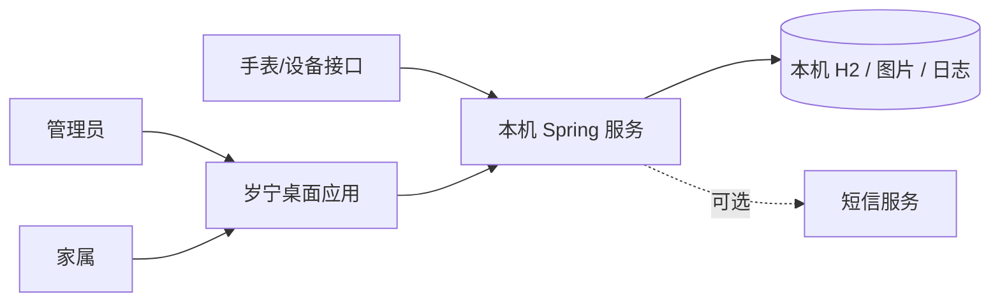
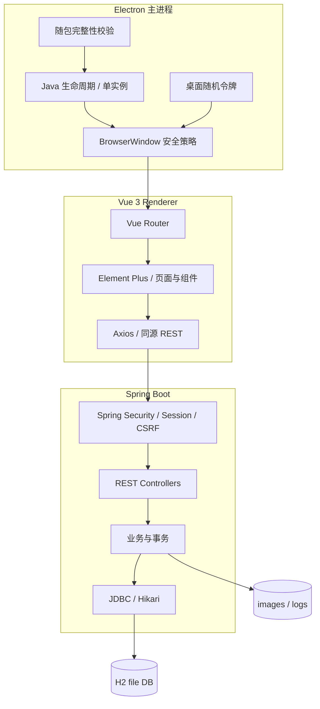
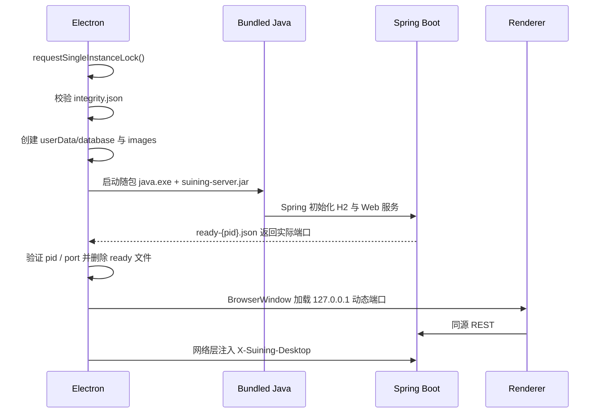

# 系统架构与工程不变量

本文说明 `preview` 分支当前系统如何组成、各层信任边界、关键数据流、失败模式以及维护者不得无意破坏的工程不变量。设计理由记录在 [Architecture Decision Records](decisions/README.md)。

## 1. 系统目标与边界

岁宁是本机优先的智慧养老桌面应用。当前交付目标是 Windows 10/11 x64 桌面环境；已公开的真实验收环境是 Windows 11，Windows 10 尚未完成实机验收。

系统由四个主要边界组成：

1. **Electron Desktop**：安装体验、进程生命周期、安全壳与本机服务启动；
2. **Vue Renderer**：管理员/家属可见的交互界面；
3. **Spring Boot Service**：身份、权限、业务接口、事务和持久化；
4. **H2 + userData**：本机数据库、上传图片和日志。

真实手表、真实短信、完整性能基准和完整渗透测试当前仍属于未覆盖边界，不能在发布说明中写成已验证。

## 2. System Context



桌面 UI 与 Spring 服务是同一产品的两个进程，但应继续按安全边界看待，而不是视作“完全可信的一块代码”。

## 3. Container View



## 4. 启动时序



关键点：

- 默认绑定 `127.0.0.1`；
- 桌面默认请求端口为 `0`，由服务实际选择可用端口；
- Electron 只接受与刚启动后端 pid 对应、端口范围合法的就绪文件；
- Renderer 不获得 Node.js 能力。

## 5. 信任边界

### 5.1 Renderer

Renderer 是低权限展示与交互层。当前 BrowserWindow 必须保持：

- `nodeIntegration: false`
- `contextIsolation: true`
- `sandbox: true`
- `webSecurity: true`
- 权限申请默认拒绝；
- 新窗口默认拒绝；
- WebView 默认拒绝；
- 下载默认拒绝；
- 非本机服务 origin 的导航被阻止。

不得为了“开发方便”在生产配置打开 NodeIntegration、关闭 sandbox 或允许任意外链。

### 5.2 Electron Main

Electron Main 可以启动进程和访问本机文件，因此权限高于 Renderer。它负责：

- 校验随包组件 SHA-256；
- 启动/关闭 Java；
- 生成桌面随机 token；
- 只在发往本机服务的网络请求头中注入 token；
- 管理单实例和异常退出。

`X-Suining-Desktop` 不得进入 localStorage、Vue store、页面源码或普通日志。

### 5.3 Spring Service

Spring 是业务安全边界。当前安全模型包括：

- 服务端 Session；
- 写请求 CSRF；
- 管理员与家属角色授权；
- 家属可访问接口使用显式 allowlist；
- 设备接口使用独立公开入口；
- 未匹配的 REST/静态路径默认拒绝；
- CSP、Same-Origin referrer policy；
- PublicRateLimitFilter；
- H2 Console 关闭。

桌面 token 不能替代业务账号授权。它只证明请求经过当前桌面进程。

## 6. 身份与首次设置

登录由 Spring 建立服务端会话，浏览器 cookie 使用 HttpOnly 和 SameSite=Lax。

首次管理员设置是特殊流程：

- Electron 启动时生成随机桌面 token；
- token 由网络层注入请求，不暴露给 Renderer JS；
- 后端首次设置逻辑必须继续保证“只能创建一次管理员”的并发安全；
- 首次设置不应退化为任何本机网页都能直接调用的无保护初始化接口。

修改首次设置流程时，必须同时更新后端安全集成测试。

## 7. 数据存储

默认数据根目录由 Electron `userData` 决定。Spring 通过 `SUINING_DATA_DIR` 获得统一路径。

当前数据包括：

- `database/suining`：H2 file database；
- `images/`：上传图片；
- `server.log` 与启动错误日志；
- `runtime/`：进程就绪文件等瞬态文件。

### 数据不变量

1. 用户数据不得存放在安装目录；
2. UI 不得绕过 Spring 直接访问 H2；
3. 覆盖升级不得清空用户数据；
4. 卸载默认保留用户数据；
5. 测试使用独立临时数据目录；
6. 破坏性 schema 变更必须提供迁移方案和回滚/备份说明。

## 8. 前端结构

前端位于 `智慧养老手表管理系统/oldIot`：

- Vue 3.5；
- Vue Router 4；
- Element Plus 2.14；
- Vite 8；
- ECharts 6。

路由使用 hash history。页面与图表按需加载，避免一次加载全部业务页面。

当前仍有若干大型 Vue SFC 与集中式 `commercial.css`。维护策略不是一次性重写，而是：

1. 用 UI/a11y/视觉门禁锁定现有行为；
2. 抽取 design tokens；
3. 抽取共享组件和 composables/API；
4. 最后拆大型页面。

这属于渐进式 strangler 重构，详见 ADR-0004。

## 9. 后端结构

后端位于 `智慧养老手表管理系统/careold`：

- Spring Boot 3.5；
- Spring Security；
- Spring JDBC；
- H2；
- HikariCP，当前连接池范围 1–4。

数据查询与事务代码应继续遵循：

- 请求读取不产生隐藏写副作用；
- 多步写入以事务定义原子边界；
- 网络调用不持有数据库事务锁；
- 最新记录查询依赖索引/排序语义，不恢复历史全表扫描；
- 连接、流和文件句柄必须确定性释放。

## 10. 桌面与运行时

桌面层位于 `智慧养老手表管理系统/desktop`。

运行时版本及摘要由 `runtime-lock.json` 固定。关键组件摘要由 `integrity.json` 在启动时验证。

退出时 Electron 向 `/restful/desktop/exit` 发出带桌面 token 的关闭请求，等待后端优雅退出；超时后才终止子进程。

## 11. 失败模式

| 失败 | 期望行为 |
| --- | --- |
| 随包文件摘要不匹配 | 阻止启动并记录错误 |
| Java 无法启动 | 不打开业务窗口，保留诊断日志 |
| 后端未在时限内 ready | 终止启动，不猜测固定端口 |
| 后端运行中异常退出 | 提示用户并退出桌面壳 |
| Session 失效 | 返回 401，UI 回到登录/恢复路径 |
| CSRF 失败 | 返回明确 403 语义，不静默吞掉 |
| 用户数据损坏 | 不自动删除数据库；优先保留证据并进入恢复流程 |
| 外部短信不可用 | 不让网络等待扩大数据库锁范围 |
| UI API 请求失败 | 给出可操作错误状态，不伪装成“无数据即正常” |

## 12. UI/UX 不变量

面向照护场景的最低契约：

- 主要交互目标 ≥48px，辅助目标 ≥44px；
- 默认正文保持至少当前 16px 基线；
- 大字模式不丢失核心操作；
- 颜色不是唯一状态表达；
- 键盘焦点可见；
- 错误、空状态和加载状态提供下一步；
- 健康数据必须表达数据新鲜度，不能把“没有新数据”解释为“正常”。

浏览器级 UI 质量检查由 `.github/workflows/ui-quality.yml` 执行。详细规范见 `UI_UX.md`。

## 13. 自动验证

核心入口：

- `.github/workflows/ci.yml`：前端生产构建、依赖审计、后端 Maven verify；
- `.github/workflows/ui-quality.yml`：真实 Chrome、Accessibility Tree、44px 目标尺寸、移动端/大字模式和视觉基线；
- `docs/TESTING.md`：自动证据与人工验收的边界。

历史验收结果见 `VALIDATION.md`，它不能替代当前 commit 的自动检查。

## 14. 发布与可追溯性

每个 preview 发布资产最终应能追溯到唯一 commit SHA。构建、验证、打包、签名和发布必须分层，普通 PR CI 不接触签名私钥。

发布流水线的目标顺序：

```text
preview commit
  -> core CI
  -> UI quality
  -> security checks
  -> Windows desktop smoke
  -> unsigned package
  -> release approval
  -> signing
  -> install/upgrade/uninstall smoke
  -> checksums + SBOM + provenance
  -> GitHub prerelease
```

## 15. 架构不变量清单

任何改动违反以下任一项，都必须视为架构变更：

1. Renderer 永远不直接获得 Node.js 权限；
2. 后端默认只绑定 loopback；
3. 桌面随机 token 不进入 Renderer JS/localStorage；
4. 用户数据不进入安装目录；
5. UI 不直接访问 H2；
6. 外部导航、新窗口、WebView、下载和权限申请默认拒绝；
7. 破坏性 DB 变更必须有迁移设计；
8. 安装/升级/卸载不得静默删除用户数据；
9. 发布资产必须关联唯一 commit；
10. 文档中的“通过”必须对应可重放命令或明确标记的人工/历史证据。

## 16. 已知限制

截至当前 preview：

- Windows 10 尚无实机验收证据；
- 未完成真实手表端到端联调；
- 未完成真实短信发送验收；
- 没有正式性能基准；
- 没有完整第三方渗透测试；
- UI 自动化目前从登录页核心视觉/a11y 基线起步，后续需扩展到登录后的主要任务流。

这些限制应保留在交接和发布材料中，直到有新证据关闭。
