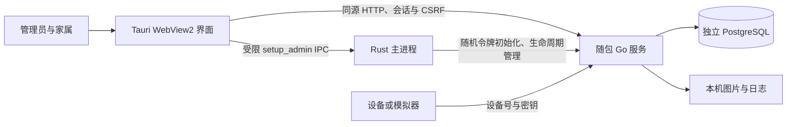

# 2.0.2 当前架构

Rust 主进程验证 Go 文件哈希，生成仅原生进程持有的桌面令牌，启动动态端口服务，验证就绪文件的 PID/端口后加载该 origin。网页导航不能越过该 origin，远程 IPC 能力只开放给本机主窗口；初始化命令还会再次核对窗口和实际 origin。

Go 先启动静态界面、退出接口与监听，再在后台连接 PostgreSQL、执行内嵌迁移。未准备好时业务请求返回 `503 DATABASE_UNAVAILABLE`；恢复后发布业务处理器。存活与数据库就绪是两种状态。数据库离线不会被显示为业务正常，也不会触发本地假写入。

会话、角色和 CSRF 仍由 Go 管理。`setup` 与 `desktop/exit` 使用随机桌面令牌保护，支持原生客户端而不依赖网页 Cookie；普通写接口继续要求会话与 CSRF。前端不持有桌面令牌，不会自动重放失败写入。

PostgreSQL 是用户确认的独立部署策略，不由安装器创建或托管。内嵌 SQL 不意味着内嵌数据库；图片仍在服务端本地目录。旧 H2 数据不是 PostgreSQL 数据，不提供未经验证的自动迁移。

数据库级外键阻止孤儿设备绑定；邀请码注册锁定长者行并条件更新，防止不同邀请码覆盖归属。图片在完整解码前检查像素上限，multipart 请求体也有限额。

旧桌面、数据库与安全边界决定由 [ADR-0006](decisions/0006-tauri-go-postgres.md) 取代。字体和照护界面契约继续有效。
