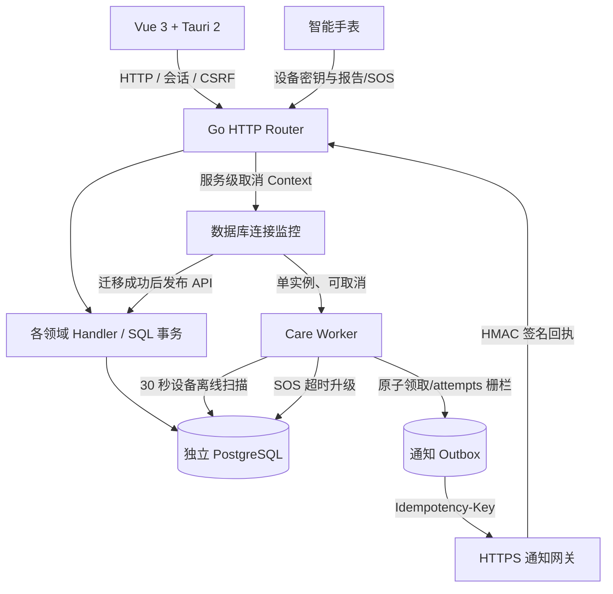

# 2.0.5-cleanup.1：底层逻辑优化与架构改进

> 目标：在不改变公开业务接口、历史数据库表结构、SOS 状态机和客户端调用方式的前提下，提高异常情况下的数据一致性、可运维性和资源边界安全。
>
> 本文记录本地源码改动；不是远程 `preview` 分支已合并、Windows 安装包已重新发布、硬件设备已联调的证明。

## 1. 优化前的重点问题

| 优先级 | 证据（原始代码） | 风险 | 处理情况 |
| --- | --- | --- | --- |
| P0 | `backend/internal/care/worker.go` 通知领取没有完成时的执行批次栅栏 | 旧 HTTP 请求返回晚于任务重领时，旧执行者可能更新后来执行者的通知状态 | 已加 `attempts` 栅栏，并移除领取之后的额外 attempts 查询 |
| P1 | `backend/internal/handlers/handler_old.go` 路由注册时启动全局 `sync.Once` 离线扫描，扫描使用 `context.Background` | 生命周期脱离服务管理、测试与数据库连接替换后可能持有陈旧连接 | 已移到 `care.Run`，随服务上下文停止，保持原 30 秒间隔及 SQL 语义 |
| P1 | `handler_auth.go` 的核心 SQL 使用 `context.Background` | 客户端断开后仍可占用数据库操作资源 | 改为请求上下文 `r.Context()` |
| P1 | `config.Load` 包含明文开发连接串；未配置时 Go 可能按 libpq 默认值尝试连接 | 不安全默认值、与操作文档所述的显式配置不一致 | 移除默认账户/密码；拒绝空 DSN；默认仅绑定 127.0.0.1 |
| P1 | HTTP server 缺少连接读写时限；通用 JSON 解析没有统一大小限制 | 慢请求和巨型请求可持续消耗连接或内存 | 加服务超时及最大 1 MiB JSON 请求体，拒绝多个串接 JSON 文档 |
| P2 | `bodyPage` 对过大分页参数不设边界；`int64Val` 截断浮点数 | 不合理查询压力和潜在的错误 ID 解释 | 限制页码 1–100000、每页 1–100，拒绝非整数和超出 int64 范围的数字 |

## 2. 优化后的进程与职责边界



实现边界：保留原 HTTP API、手表协议、状态机、HMAC 回执和数据库约束。**不是**宣称已将所有 Handler 改造成领域驱动架构或独立微服务。业务层目前仍含 SQL，属于下一阶段分层重构工作。

### SOS 通知的并发栅栏

1. PostgreSQL 原子领取任务并将 `attempts` 自增，返回当前领取批次。
2. 在网关请求期间，若出现旧租约超时，另一执行者可以重新领取并获得更大的 attempts。
3. 只有 `WHERE id=$1 AND status='sending' AND attempts=$2` 匹配本次批次时，才允许写入 `sent` 或 `failed`。
4. 收到经过 HMAC 校验的 `delivered` 回执仍由独立事务更新。旧执行者不能将其覆盖为失败。
5. 请求头 `Idempotency-Key` 仍以通知 ID 为基础；网关必须提供幂等处理，数据库栅栏不等同于外部网关绝对恰好发送一次。

**行为不变**：网关返回 HTTP 2xx 仅意味着已接受请求，不能代表家属已接收，也不能代表现场人员已完成处置。

### 离线扫描生命周期

过去：路由注册 → `sync.Once` → 无限循环 → 使用首个 Handler 的数据库连接。

现在：数据库完成迁移 → 统一启动 `care.Run(ctx, pool)` → 30 秒周期扫描，单次扫描有 10 秒超时 → 服务上下文取消 → 等待后台 worker 退出 → 关闭连接池。

保持原有离线判断（120 秒）、递增 `boot_seq`、清理确认状态与 `last_online_at`。对同一离线会话重复扫描不会重复累计 `boot_seq`。

### 安全默认值与行为兼容

- **必须提供** `DATABASE_URL`（直接启动 Go）或 `SUINING_DATABASE_URL`（Tauri 桌面传给 Go），不再尝试源码内置 `careold/careold` 明文凭据。
- 未配置数据库时，Go HTTP 进程仍可提供界面和 `GET /api/v1/service/status`；数据库业务 API 将继续返回 `503 DATABASE_UNAVAILABLE`。
- `ADDR` 默认改为 `127.0.0.1:8080`。要接受手表通过其他主机远程访问，运维人员必须明确设置监听地址，并配置可信网关、认证与防火墙。仅改变 `ADDR` 不提供 TLS 或公网部署安全保障。
- 通用 JSON 接口最大请求体为 1 MiB；图片上传另走原有 multipart 和文件尺寸限制，不使用通用 JSON 限额。
- 存量记录、迁移文件、数据库表定义、设备鉴权协议及前端界面均未修改。
- 这些默认值属于**有意的部署配置变更**，更新环境变量之后再启动或发布安装包。

## 3. 已新增的回归用例

- `internal/care/worker_test.go`：旧通知请求返回较晚不能覆盖被重新领取的任务；30 秒扫描核心 SQL 同一离线会话只触发一次；退避时间具有上限。
- `internal/handlers/request_limits_test.go`：合法 JSON、拒绝多份 JSON、超大请求体、空可选设备请求、异常 ID、异常分页。
- `internal/config/config_test.go`：没有数据库凭据、默认回环监听、允许运维显式覆盖配置。
- `internal/db/db_test.go`：空数据库 DSN 不应触发 libpq 默认配置连接。

## 4. 本地验证结果与限制

| 检查 | 结果 |
| --- | --- |
| `gofmt`（所有本次改动 Go 文件） | 完成 |
| Go 语法解析（63 个 `.go` 文件） | 63 / 63 解析通过 |
| `GOTOOLCHAIN=local GO111MODULE=off go test ./internal/config` | 通过，2 项 |
| `node --test watch-sim/watch-sim.test.cjs` | 通过，3 项 |
| 前端 `oldIot/src` JavaScript 文件 `node --check` | 通过 |
| Go 1.24 全量 `go test ./...` | **未执行成功**：此环境仅 Go 1.23.2，无法联网下载 Go 1.24 工具链及 Go 依赖 |
| `TEST_DATABASE_URL` 数据库并发与迁移集成测试 | **未运行**：无可用的独立测试 PostgreSQL 数据库 |
| Tauri/Windows 构建及真实手表、真实短信通知网关联调 | **未运行**：缺少对应 Windows 与设备运行环境 |

不能将仅通过语法验证解释为完整构建和生产验收通过。合并前应使用 Go 1.24 和临时独立 PostgreSQL，执行：

```bash
cd 智慧养老手表管理系统/backend
export TEST_DATABASE_URL='postgres://.../isolated_test_database?sslmode=require'
go test ./... -count=1
go test -race ./internal/care ./internal/handlers ./cmd/server

gofmt -l ./internal ./cmd
```

然后在 Windows 上重新完成 Tauri 侧载 Go 的启动/退出测试，并使用故障注入复现：断数据库、手表重试 SOS、通知 5xx 与重领、签名回执先到、同一长者多次离线。

## 5. 下一阶段建议（未实现）

1. **P0 业务幂等性闭环**：评估旧手表未上传 `requestId` 的 SOS 情形，并将设备报警写入、持久通知队列、升级、回执形成端到端追踪；为外部网关配置事务幂等键和有效期。
2. **P1 业务分层**：逐步将 `handlers/handler_*` 拆成 Transport/UseCase/Repository 三层；优先抽离 SOS、设备鉴权和长者家属关系三个领域，保留旧 HTTP JSON 响应协议。
3. **P1 多实例部署**：目前内存会话与全局异步通知不适合不加设计地横向扩展。部署多实例前引入共享会话或明确会话亲和；排查其他非数据库持久队列。
4. **P1 数据治理与隐私**：按长者/家属归属实施全路径授权测试，数据库加密传输与凭据轮换，制定健康数据和位置数据留存、备份与访问审计方案。
5. **P2 可观测性与容量**：新增请求 trace ID、SQL 延迟分布、DB 连接池等待、通知任务积压/尝试次数、离线误报率，并进行基准负载测试和告警演练。

本阶段没有声称完成 UI 重设计、数据库迁移升级、跨平台打包或云端多租户改造。
