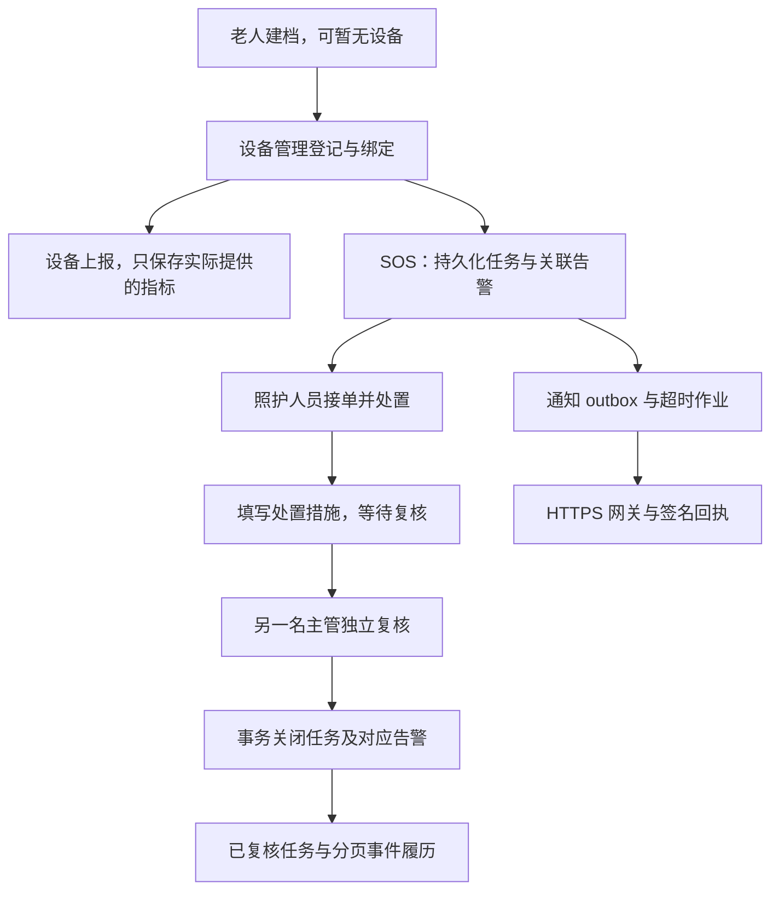

# 照护与数据闭环：缺陷、修复与验收

日期：2026-10-19。对象为用户提供的 `Suining-2.0.5-optimized.1-source.zip`，延续此前已完成的 UI 修改。本轮为本地源码修复，未发布新的安装包或修改远程仓库。

## 范围和结论

按用户确认，**保留现有后台权限，先补齐照护与数据闭环**。护理员、审计员的岗位约束继续只覆盖照护功能；老人档案、设备、公告等现有管理员权限没有扩大或收紧。

主要缺陷是各模块之间缺少一致的约束：页面组件未接入、字段契约不一致、档案与设备关联可从不同入口分别改写、缺测值被表示成正常，以及任务关闭没有回写关联告警。本轮在原有 Vue / Go / PostgreSQL 结构中修复这些路径，没有引入新服务或数据库迁移。

此前交付的导航术语与折叠、老人窄屏卡片、五页加载与重试、密码锁图标、总览数据说明及宽屏栅格均保留在本次完整源码包中。

## 已补齐的具体缺陷

以下“原行为”由源码、修改前的失败测试或真实请求确认；“验证”区分真实数据库与模拟 API 浏览器测试。

| 缺陷与触发条件 | 原行为及影响 | 修复 | 验证 |
| --- | --- | --- | --- |
| 总览打开照护任务 | `main.vue` 导入 `CareInbox`，却没有在 Options API 的 `components` 中注册；组件不挂载，也不请求任务 | 注册组件，显示任务、状态和处理入口 | 真实 UI 登录后读取任务；模拟浏览器确认发起 API 请求 |
| 编辑手表阈值 | API 只返回 `device_id`，前端读取 `deviceId`，编辑时缺少设备标识 | 返回 `deviceId` / `opTime`，同时保留旧 snake_case 字段 | Go 契约测试；真实页面修改阈值并读取数据库结果 |
| 查询饮食和药物字段 | SQL 的 `food_like`、`food_hate`、`drag` 扫描目标顺序错误，三个字段错位 | 修正列表及详情扫描顺序 | Go 回归；真实建档后核对喜好、忌口、常用药 |
| 新建尚无手表的老人 | 建档要求已有阈值档案和设备 ID，设备绑定又要求老人存在，流程互相依赖 | 支持先建未绑定档案；表单移除手填设备 ID；设备登记和绑定由设备管理完成 | Go 创建测试；真实浏览器先建档、后登记和绑定 |
| 从档案编辑改设备 | 只改 `oldperson.device_id`，设备表的 `old_id` 保留原值，双向引用可能矛盾 | 档案编辑不写设备归属；非空设备 ID 与当前主设备不一致时返回 409；界面只读并说明操作入口 | Go 测试拒绝越过绑定流程的改写 |
| 将已绑定设备直接绑到另一人 | 原归属可能被覆盖，前一位老人的主设备引用仍指向它 | 事务先锁老人、再锁设备并重新检查归属；跨人改绑须先解绑；拒绝时不消耗绑定码 | Go 真实库测试；20 轮绑定/解绑并发回归检查引用一致 |
| 注册、重绑已有阈值的设备 | 默认阈值 upsert 覆盖人工设置 | 只补建不存在的阈值档案，已有值不覆盖 | Go 自定义阈值保留测试 |
| 同一老人多设备，移除主设备 | 新登记设备会替换主设备；解绑会直接置空，忽略其他仍绑定设备 | 已有主设备时保留；主设备解绑或删除时选取剩余已绑定设备中的最小编号 | Go 多设备及解绑回归 |
| 设备只上报部分指标 | 缺失心率/血压写成 0；只上报步数也会产生 0 睡眠及正常状态 | 未上报的指标与对应状态保留 NULL；有值时才计算状态 | Go HR-only / steps-only 测试；真实 HR-only 请求检查血压为空 |
| 任务或履历超过首批记录 | 前端只显示首批任务，履历 SQL 静默截断前 100 条，没有总数和翻页入口 | 活跃/已复核任务按范围查询，返回总数；任务与履历均支持分页 | 真实库 55 个活跃/5 个已复核、105 条履历；模拟界面遍历 61 个任务 |
| 岗位与复核约束在 UI 中不明确 | 不可用动作仍显示，处置人会看到自己的复核按钮 | 读取服务端岗位与操作者 ID，按岗位显示动作，隐藏本人复核；后端原有鉴权继续执行 | Go 原有权限测试；模拟三岗位；真实两账号独立复核 |
| 处置失败和中文长记录 | 错误在弹窗后方；后端把“2000 字符”按字节限制，正常中文记录提前被拒绝 | 弹窗内提示错误并保留输入；按 Unicode 字符计数；保存期间禁止关闭弹窗和重复提交 | Go 1200 个中文字符测试；模拟 409 后保留输入；真实提交同长度记录 |
| 独立复核关闭 | 任务已关闭，但关联定位告警仍显示待处理 | 在同一事务中只清除 `source_alarm_id` 指向的告警；不清除同设备后来产生的其他告警 | Go 两条告警隔离测试；真实关闭后查询位置告警及完整履历 |
| 关闭后查看总览数字 | 总览统计只在打开页面时查询，任务已关闭后仍显示旧摔倒数量 | 复核成功后通知总览刷新位置告警统计 | 真实浏览器先复现旧值滞留，再验证无需重开页面更新为 0 |
| 服务心跳正常但通知没有配置 | 单独显示进程正常，无法判断是否能发送或验证送达 | 诊断返回网关/回执配置布尔值；页面分别提示；15 秒刷新心跳；不返回 URL 或密钥 | Go 诊断测试；模拟缺配置和心跳变化；真实服务显示未配置 |
| 监护人超过默认第一页 | 建档选择框只请求默认首批 20 人，后面的监护人无法选择 | 读取完整分页后再显示；任一页失败清空部分结果、在表单内提示并允许重试 | 模拟 205 人，第二页失败后重试并选择最后一人 |

实现集中于 `backend/internal/handlers/handler_{old_person,watch_info,device_*,care_*}.go`、`internal/care/worker.go`、前端 `main.vue`、`person.vue` / `person.logic.js` 和两个照护组件。

## 补足后的业务关系



- `device.old_id` 表示设备归属；`oldperson.device_id` 保留兼容的主设备指针。绑定/解绑事务统一维护两者，普通档案编辑只修改档案内容。
- `watch_info` 是设备阈值配置，不能成为“老人能否建档”的前置条件；绑定只补缺失配置。
- 求助接收、渠道接受通知、渠道确认送达、人员接单、处置和复核是不同事实。进程心跳正常不能替代其中任何一项。
- 既有状态机、独立复核约束、持久化通知 outbox 与签名回执机制继续沿用；本轮使界面、分页查询与关闭回写接上这些机制。

## 本地验证

| 层级 | 执行内容与结果 | 能证明什么 |
| --- | --- | --- |
| 修改前基线 | 原有 Go 全套测试通过；新增回归在修复前产生失败 | 原有测试覆盖不足，不能用旧测试全绿代替业务链路验证 |
| Go / 真实 PostgreSQL | 新增 14 个回归测试函数；`go test -race -count=1 -timeout180s ./...` 全部通过 | 本轮业务规则、数据库事务、并发绑定与原有测试在本地通过；不是全部并发风险消除的证明 |
| 静态检查 | `go vet ./...` 通过，改动 Go 文件 gofmt 检查通过 | 本地编译检查与格式检查通过 |
| 前端构建 | `npm run build` 通过 | 生产资源可生成；仍有既存的大包体积提示 |
| 模拟 API 浏览器 | 执行 `node qa/run.cjs` 的 11 组验收；新增架构组覆盖分页、岗位、失败恢复、诊断刷新、390px 标准/大字及监护人分页 | 页面交互及响应契约通过模拟 API 验证，不代表真实手表或通知服务成功 |
| 真实业务浏览器 | 生产 Vue 资源 + 实际 Go 进程 + 独立 PostgreSQL，14 项检查通过，无 API mock | 登录 → 建档 → 绑定 → 阈值编辑 → 部分指标上报 → SOS → 处置 → 另一账号复核 → 告警和总览同步 → 查询完整履历走通，无页面 JS 错误 |

真实数据库仅为本机新建的隔离测试环境。Go 测试使用各自临时 schema；真实浏览器脚本要求 `CARE_E2E_TEST_ONLY=1`、回环地址、`qa_arch_` 前缀 schema，并拒绝初始化非空库。测试没有调用真实短信网关，没有使用生产数据。

修复过程的并发测试曾发现一次新增锁顺序不一致，已改为“先老人、后设备”并重新通过全套竞争检测；这是本轮实现过程中发现并修正的问题，不作为原始源码缺陷重复计数。

### 复跑入口

在 `智慧养老手表管理系统/backend` 配置指向**专用测试数据库**的 `TEST_DATABASE_URL` 后运行：

```powershell
go test -count=1 -timeout180s ./...
go test -race -count=1 -timeout180s ./...
go vet ./...
```

Windows 的 `-race` 需要可用的 C 编译器及启用 CGO。在 `oldIot` 构建，再安装 `qa` 锁定依赖和对应 Playwright 浏览器，执行：

```powershell
npm ci
npm run build
npm --prefix qa ci
node qa/run.cjs
```

也可通过 `CARE_CHROME_PATH` 指向已有 Chromium。真实后端脚本为 `qa/real-backend-acceptance.cjs`，需先创建全新隔离 schema、运行带当前前端产物的 Go 服务，并提供 `CARE_E2E_BASE`、`CARE_E2E_SCHEMA`、`CARE_E2E_DESKTOP_TOKEN`、`CARE_E2E_PSQL`、`CARE_E2E_PGPORT` 与上述测试开关；其 psql 测试用户为 `architecture_test`。不要让测试配置指向业务库。

## 剩余边界

1. **权限范围**：按用户决定保留原后台权限。照护岗位不是覆盖所有管理页面的全局权限系统，也不是多机构隔离方案。
2. **历史数据**：本轮约束新写入和后续操作，不批量修复既有错误归属、历史错位字段或已经写成 0 的缺测数据。历史清理需先核对实际记录和备份。
3. **关系模型**：保留双向兼容字段，完整性由相关事务及既有外键共同维护；尚未迁移为单一关系模型或添加完整的反向复合约束。直接 SQL、旧服务并行写入仍需部署约束。
4. **通知与现场交付**：未执行真实手表、短信/电话、外部网关、24 小时值守、Linux 服务或 Tauri 原生窗口验收。桌面关闭后的告警持续运行仍依赖独立照护服务部署，见 [部署说明](CARE_SERVICE_DEPLOYMENT.md) 和 [交付门槛](CARE_2.0.5_GATES.md)。
5. **运营统计**：总览沿用历史上报中异常设备的分类去重口径，同设备可能计入多类，不能当作当前未处置任务数。本轮没有编造昨日或七日趋势。
6. **后续规模化**：岗位人员列表和敏感访问审计仍有既有数量上限，未在本轮改为完整检索分页；数据留存、历史清理及全面字段校验也不属于已经完成的功能。

交付包含完整源码、相对此前 UI 交付的增量补丁、文件校验清单，以及独立保存的本地验收结果和截图。构建产物、测试库、设备密钥、桌面令牌及本机日志不进入源码 ZIP。
