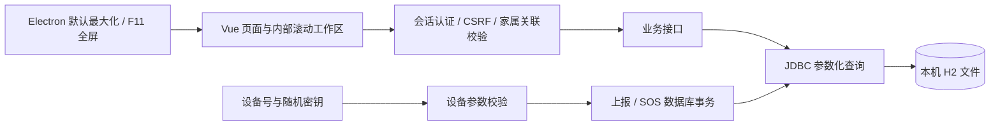
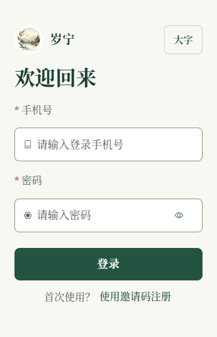

> 历史阶段记录；2.0.2 已迁移至 Tauri / Go / 独立 PostgreSQL。当前构建与验收以 BUILD、ARCHITECTURE 和 VALIDATION 为准。以下路径与结果仅描述记录时的版本。

# 后端与屏幕布局优化验收 · 2026-10-16

## Context

本轮按两份附件 senior-backend / senior-backend-dev 的审查顺序推进：安全、正确性、架构、性能、可维护性。保留 Electron + Vue 3/Vite + Spring Boot 3/JDBC/H2 单体结构，没有添加运行依赖或改动数据库结构。附件所引用的 Java 栈参考文件、模板和脚本未随附件提供，未声称执行这些缺失内容。

用户后续明确：**登录后的首页可以滚动**。因此仅登录页默认适配一屏，首页和业务页面在工作区内滚动。工作仅在本地 preview 分支完成，未提交、推送、运行远程 Actions 或更新 Release/安装器。

## 计划与执行

先在独立真实 H2 中补回归检查，首轮 10 项中 7 项失败。失败覆盖部分写入残留、阈值不一致、缺省和零值处理、非法参数、重复更新；其中邀请码检查还暴露了年龄为空导致实体映射失败的问题。随后完成修复，增加边界与告警回归，最终新增测试类包含 14 项测试。

| 问题 | 改进与验证依据 |
| --- | --- |
| 设备上报或 SOS 后续写入失败时，前面的健康、位置、日数据或告警已经提交 | 为多表写入添加事务；在真实表约束中故意制造末尾失败，确认前面所有写入均回滚 |
| 邀请码批量生成途中失败留下部分可用邀请码 | 批量生成使用同一事务；生成器未返回 ID 时抛出失败，数据库约束拒绝第二条时第一条也回滚 |
| 上报始终用固定阈值，且新档案的高低默认值写反 | 读取档案实际阈值，修正新档案默认顺序；兼容历史倒置值；无档案时保留原有默认范围 |
| 修改阈值后旧告警解释失真 | 详情标明当前档案范围；原异常读数已处于当前范围时显示“历史异常”，保留原始异常记录 |
| 无效阈值可进入档案 | 新增和编辑先校验必填数字、合法范围及低值小于高值；无效输入返回 400，不改变原数据 |
| 只上报步数可能清空已有睡眠，明确的零值又被忽略 | 缺省项使用 null 表示，在原子日记录更新中保留原值；显式零值正常写入，同设备同日保持一行 |
| 心跳执行两次设备更新，缺省电量和版本覆盖已有资料 | 合并为一次 SQL，缺省元数据保留原值；在线与上报时间同步，离线扫描包含时间相等的情况，单次离线只计一次 |
| 非法坐标、时间、数值及过长字段直到写库才失败，或被静默变成零 | 所有上报字段在写入前校验，保留协议中零心率/血压表示未测量的语义；经纬度成对、有限且在范围内 |
| 家属只查看一人记录仍排序所有人的历史 | 健康、活动、位置查询先限定长者或设备，再通过已有索引按顺序取一行；健康日期过滤仍在确定最新记录后应用 |
| 热点档案查询连接无关的老人表 | 设备阈值读取直接查询 watch_info 主键，删除不需要的关联查询；复用线程安全的时间格式器 |
| 可空年龄无法映射到 int | 年龄改为 Integer，保留“未填写”的 null，避免读取档案及生成邀请码时报错 |

事务使用 Spring 的声明式事务代理，数据库故障测试经 Spring 注入的代理调用入口，不在测试外层开启事务来掩盖问题。参照 [Spring 事务说明](https://docs.spring.io/spring-framework/reference/data-access/transaction/declarative/annotations.html)。

显示层在原有风格上调整纵向留白：默认最大化；F11 进入原生全屏，Esc 退出；宽屏内容使用完整可用宽度。登录短屏收起辅助文案，保留字号切换、手机号、密码、显隐密码、登录和注册入口。首页保持滚动，移动端导航仍有独立空间。窗口采用 [Electron 原生窗口 API](https://www.electronjs.org/docs/latest/api/browser-window)。

## 验收

| 检查 | 结果 |
| --- | --- |
| 后端测试及可执行 JAR 打包 | 52 项通过，0 失败、0 错误、0 跳过；含 14 项新数据库回归 |
| 新增屏幕检查 | 169 项通过；8 种尺寸、标准字/大字、登录、管理员和家属首页 |
| 既有页面、搜索边框、表单、首次设置、组件生命周期回归 | 全部通过；逐次检查数量取实际 JSON 报告，部分请求检查随异步时序变化 |
| 真实 Windows Electron + 随包 Java 21 + 新构建 JAR | 19 项通过；最大化、F11/Esc、无系统边框、恢复窗口、隐藏验收模式、无 Node 权限、真实账号创建和登录、会话保持、首页可滚动、服务正常退出、没有残留 Java 进程 |
| 字体与图形 | 95 项字体及样式文件 SHA-256 与修改前一致；品牌图形未修改 |
| 前端生产构建、差异空白检查 | 通过；没有新增依赖 |

屏幕尺寸为 360×560、390×844、760×640、1024×600、1366×768、1440×900、1920×1080、2560×1440。检查页面溢出、登录面板内容高度、校验提示、键盘顺序、可用宽度、内容底部可达性及移动端导航遮挡。原生窗口验收另外读取 Windows 窗口样式，确认全屏没有标题栏或调整大小边框。

最终微调：解决 360×560 大字登录的 14px 溢出；修正合并心跳后的时间相等条件；保持旧异常的历史含义；将查询字段拆成明确常量，避免截取 SQL 文本；补齐无界面验收模式的隐藏处理。

## 截图

以下截图来自生产构建的真实渲染，业务数据使用验收夹具，不是个人真实数据。Electron 无界面的 capturePage 返回 UnknownVizError，因此截图由 Chromium 单独生成；不将截图结果当作安装器或 ASAR 完整性验收。

## Trade-offs 与边界

- 按用户要求没有进行性能基准或负载测量，优化依据是减少明确的重复 SQL、缩小查询范围和修复数据一致性，不承诺加速倍数。
- 每次健康上报读取当前阈值，避免缓存过期；只在需要心率/血压判定时读取，使用主键查询。没有新增 Redis、ORM 或迁移工具。
- 新增短事务保证原子性，没有把外部网络等待放入事务。没有改变数据库结构，已有用户数据无需结构迁移。
- 登录在上述尺寸下无需滚动；更短的屏幕、系统放大或软键盘出现时允许面板内部滚动，确保关键操作可达。登录后首页始终保留工作区滚动。
- 生产构建仍提示主入口约 685 kB 超过默认 500 kB 分块告警线；构建成功，未以调整告警阈值掩盖提示，本轮重点在后端。
- 没有真实手表、短信服务或多台物理 Windows 设备联调；没有重新构建、签署或发布 EXE 安装器。

可复验的日志、测试脚本及原生窗口记录位于项目本地 `outputs/backend-screen-20261016/`，按仓库规则不纳入 Git。源码回归测试保留在 `careold/src/test/java/com/example/careold/controller/DeviceWriteTransactionTests.java`。
