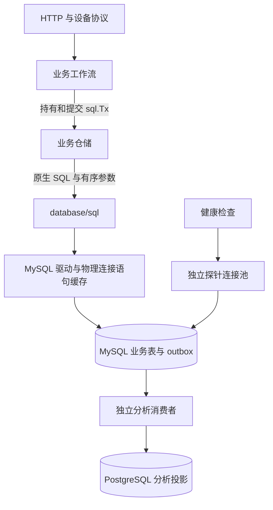

# 原生 MySQL 业务持久化

业务执行内核直接使用 `database/sql` 与 MySQL 8.4。仓储拥有 MySQL SQL；工作流拥有事务；驱动拥有参数转换和物理连接。PostgreSQL 只处理异步分析投影。



## 执行契约

`db.Database` 组合业务 `*sql.DB` 与独立健康探针。业务调用使用 `ExecContext`、`QueryContext`、`QueryRowContext` 和 `BeginTx`；事务是标准 `*sql.Tx`，通过 `Commit()` 或 `Rollback()` 结束。工作流显式指定 `sql.LevelReadCommitted`。

查询返回 `*sql.Row` 或 `*sql.Rows`，无记录错误是 `sql.ErrNoRows`。写入返回标准 `sql.Result`；调用方处理 `RowsAffected()` 的数量与错误。`db.InsertID` 从同一次 INSERT 的 `LastInsertId()` 取得主键，不另取连接查询连接级状态。

`db.RowQuerier` 只描述标准 `QueryRowContext` 能力，使仓储可以接受业务池或调用方事务。`db.QueryEach`、`db.QueryList` 在返回前关闭标准结果集，不建立另一套结果类型。

## SQL 所有权

- 每个 `?` 绑定一个参数，参数严格按 SQL 出现顺序排列。相同值出现多次时，仓储明确传入多次。
- 可选筛选、分页、批量 VALUES 与 IN 列表同时构造 SQL 结构和对应参数；用户输入只进入绑定参数。
- 时间使用 `CURRENT_TIMESTAMP(6)` 或显式时间参数；字符串拼接使用 `CONCAT`。连接不启用 `PIPES_AS_CONCAT`。
- upsert 使用 MySQL 行别名；引用已有行的同名列时限定目标表，区分当前状态和新观测。
- 批量健康写入直接经过标准参数转换。可复用的 SQL 模板只保存结构；患者数据和参数不进入共享缓存。

执行路径已删除 PostgreSQL 占位符翻译、运行时参数重排、全局查询计划缓存、自定义 `Transaction` / `CommandResult` / `Row` / `Rows`，以及绕过标准参数转换的私有批量载体。没有旧执行接口或方言回退。

物理连接上的预编译语句缓存仍由 MySQL 连接器管理。`MYSQL_STMT_CACHE_SIZE` 控制服务器句柄预算；设为 0 时由标准驱动选择插值或临时 prepare，业务契约一致。

## 一致性边界

设备绑定、SOS 幂等记录、告警快照、照护状态和 outbox 继续在同一 MySQL 事务提交。重复上报不产生额外事件；重新绑定后的数据与告警按绑定版本隔离。外部通知在领取事务提交后发送，重试与语音升级同时保留任务 ID、租约和尝试次数约束。

位置告警处置与照护复核统一调用告警仓储的 `Resolve`，按快照、告警的顺序加锁，并同时写入历史告警状态和当前快照。复核较早的告警不会清除后来发生的告警。

PostgreSQL 的 pgx 连接、事务和占位符属于独立分析消费者及其运维工具。业务仓储使用标准 SQL 类型，不能将 pgx 事务作为业务事务传入。

## 验证

配置独立测试 MySQL 和 PostgreSQL 后，在 backend 目录执行：

```powershell
go test -race -count=1 -timeout 900s ./...
go build ./...
go vet ./...
```

`TestBusinessSQLUsesNativeMySQL` 检查业务源码不重新引入 PostgreSQL 参数。真实数据库测试覆盖参数传输、语句缓存、事务回滚、迁移与重建、设备绑定并发、SOS 重试、通知租约、健康批次和异步投影。手表的真实后端端到端测试验证完整 HTTP 链路。
