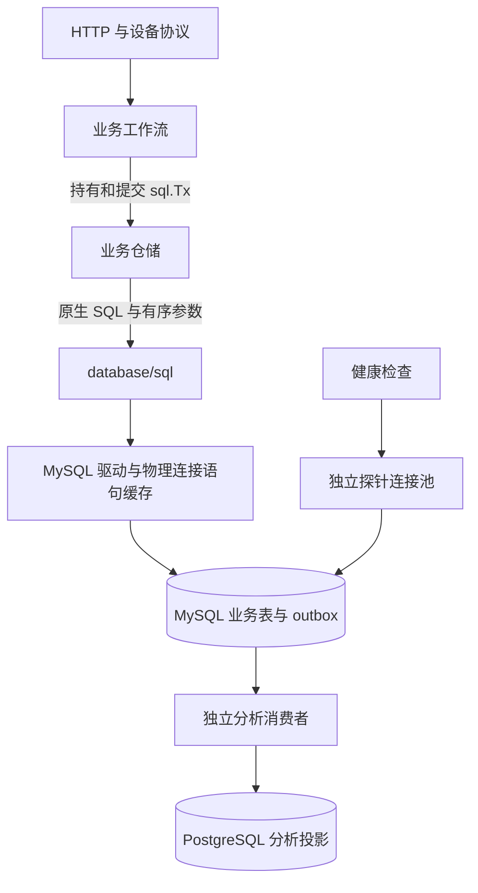

# 原生 MySQL 业务持久化

业务执行内核直接使用 `database/sql` 与 MySQL 8.4。仓储拥有 MySQL SQL；工作流拥有事务；驱动拥有参数转换和物理连接。PostgreSQL 只处理异步分析投影。



## 执行契约

`db.Database` 组合业务 `*sql.DB` 与独立健康探针。业务调用使用 `ExecContext`、`QueryContext`、`QueryRowContext` 和 `BeginTx`；事务是标准 `*sql.Tx`，通过 `Commit()` 或 `Rollback()` 结束。工作流显式指定 `sql.LevelReadCommitted`。

查询返回 `*sql.Row` 或 `*sql.Rows`，无记录错误是 `sql.ErrNoRows`。写入返回标准 `sql.Result`；调用方处理 `RowsAffected()` 的数量与错误。`db.InsertID` 从同一次 INSERT 的 `LastInsertId()` 取得主键，不另取连接查询连接级状态。

`db.RowQuerier` 只描述标准 `QueryRowContext` 能力，使仓储可以接受业务池或调用方事务。`db.QueryEach`、`db.QueryList` 在返回前关闭标准结果集，不建立另一套结果类型。

## SQL 所有权

- 每个 `?` 绑定一个参数，参数严格按 SQL 出现顺序排列。相同值出现多次时，仓储明确传入多次。
- 可选筛选、分页、批量 VALUES 与 IN 列表同时构造 SQL 结构和对应参数；用户输入只进入绑定参数。
- 时间使用 `CURRENT_TIMESTAMP(6)` 或显式时间参数；字符串拼接使用 `CONCAT`。连接不启用 `PIPES_AS_CONCAT`。
- upsert 使用 MySQL 行别名；引用已有行的同名列时限定目标表，区分当前状态和新观测。
- 批量健康写入直接经过标准参数转换。可复用的 SQL 模板只保存结构；患者数据和参数不进入共享缓存。

执行路径已删除 PostgreSQL 占位符翻译、运行时参数重排、全局查询计划缓存、自定义 `Transaction` / `CommandResult` / `Row` / `Rows`，以及绕过标准参数转换的私有批量载体。没有旧执行接口或方言回退。

物理连接上的预编译语句缓存仍由 MySQL 连接器管理。`MYSQL_STMT_CACHE_SIZE` 控制服务器句柄预算；设为 0 时由标准驱动选择插值或临时 prepare，业务契约一致。

## 一致性边界

设备绑定、SOS 幂等记录、告警快照、照护状态和 outbox 继续在同一 MySQL 事务提交。重复上报不产生额外事件；重新绑定后的数据与告警按绑定版本隔离。外部通知在领取事务提交后发送，重试与语音升级同时保留任务 ID、租约和尝试次数约束。

位置告警处置与照护复核统一调用告警仓储的 `Resolve`，按快照、告警的顺序加锁，并同时写入历史告警状态和当前快照。复核较早的告警不会清除后来发生的告警。

PostgreSQL 的 pgx 连接、事务和占位符属于独立分析消费者及其运维工具。业务仓储使用标准 SQL 类型，不能将 pgx 事务作为业务事务传入。


## 遥测状态投影

设备在线状态是可覆盖投影，SOS、告警、照护和持久遥测收件箱仍由 MySQL 事务保障，不进入心跳合并缓冲。

- 心跳携带鉴权所得的 `health_epoch`，数据库写入需同时匹配 `device_id` 与绑定版本；过时绑定无法改写当前设备状态。
- 批量与直接写入都检查观测时间，拒绝回退电量、客户端版本和在线时间；SQL 过滤条件先于更新生效，不依赖多表 `UPDATE` 的赋值顺序。
- 内存合并缓冲最多保留 8192 个设备状态名额，待写入批次也占名额。重复设备合并，不额外消耗名额。
- 容量已满时，新设备心跳直接进行带版本校验的同步写入；数据库失败返回 HTTP 错误，不虚假确认写入成功。
- 同一缓冲的 Flush 串行执行；失败批次重新入队，并按绑定版本、观测时间合并。容量控制属于心跳路径，不改变可靠告警的持久化契约。

这个边界避免了为可覆盖状态引入额外分布式队列，也不以丢弃数据冒充背压。性能变化须通过实际设备数和 MySQL 负载基准评估。

## 验证

配置独立测试 MySQL 和 PostgreSQL 后，在 backend 目录执行：

```powershell
go test -race -count=1 -timeout 900s ./...
go build ./...
go vet ./...
```

`TestBusinessSQLUsesNativeMySQL` 检查业务源码不重新引入 PostgreSQL 参数。真实数据库测试覆盖参数传输、语句缓存、事务回滚、迁移与重建、设备绑定并发、SOS 重试、通知租约、健康批次和异步投影。手表的真实后端端到端测试验证完整 HTTP 链路。


## 显式照护主管与历史权限迁移

首次安装由 `authrepo.InitializeAdmin` 在同一个事务中创建管理员、授予 `supervisor` 岗位并写入 `supervisor_initialized` 审计记录。 `care_staff_permission` 是唯一岗位事实源；未分配岗位的管理员没有主管权限。

迁移 `0027_explicit_care_authority.sql` 只清点历史管理账户与当时已有的岗位写入 `care_duty_migration_inventory`，**不将未分配账户自动提升为主管**。部署前先核对快照：

```sql
SELECT admin_id, observed_duty FROM care_duty_migration_inventory ORDER BY admin_id;
SELECT u.user_id, p.duty FROM users u
LEFT JOIN care_staff_permission p ON p.admin_id=u.user_id
WHERE u.role='1' ORDER BY u.user_id;
```

已有至少一位显式主管的实例继续正常授权。若旧实例没有显式主管，应由有数据库管理权限的服务器运维人员明确选定现有管理员账号，在服务器本地执行：

```sh
MYSQL_DSN='...' go run ./cmd/care-supervisor --admin-id=123 --reason=INC-2026-117
```

命令在事务中获取 `app_metadata` 锁，只在没有任何显式主管时创建首位主管，验证账户存在且角色为管理员，并写入 `supervisor_local_bootstrap` 审计。不能通过公共 HTTP 接口执行；已有主管时使用受权的岗位管理接口。

已迁移的敏感接口以事务内岗位锁作为最终授权依据；旧 `EnforceAdminDuty` 仍为未迁移接口的临时路由门禁，不具备事务级并发撤权保证。每条新后台入口须在读取私密数据或修改业务状态的同一事务中重新检查能力，完成迁移后才能移除通用门禁。

岗位分配、撤权和账户生命周期更新都先获得 `app_metadata` 单例排他锁，再锁定操作者的实时主管岗位及目标账户；所有写入在同一个事务内执行。`carerepo.SetDuty` 拒绝撤销最后一位有效主管，`careworkflow.ChangeAccountStatus` 对并发停用、恢复和注销执行相同的不变量检查。

迁移 `0028_admin_account_lifecycle.sql` 为 `users.account_status` 引入 `active`、`suspended` 和 `retired`。管理员登录、会话显示、旧路由门禁与事务内岗位授权均拒绝非 `active` 状态。主管可以通过 `POST /api/v1/care/accounts/status` 修改其他管理员状态；自身不能被自身停用或注销。数据库会话撤销、账户状态及 `care_access_audit` 在同一事务提交，HTTP 成功后还撤销当前进程内的会话。

`retired` 是不可恢复的逻辑注销：阻断登录并撤销岗位，保留必要的历史审计关联，**不代表数据库中的个人信息已经物理擦除**。若要满足实际数据删除或保留期限要求，须另行实施清理策略。迁移回滚会移除账户状态字段，应先确认不存在需要保持停用的账户，避免重新开放历史凭据。


## 照护岗位能力矩阵

岗位存储以 `care_staff_permission` 为唯一事实源。Go `carepolicy.Allowed` 判定请求能力；前端仅依据会话中实时查询的 `duty` 决定显示哪些操作。后端每次请求重新授权，照护状态写入还在事务内用 `FOR SHARE` 锁定操作者的岗位，避免权限撤销与提交竞态。

| 能力 | 主管 supervisor | 护理员 caregiver | 审计员 auditor | 未分配 |
| --- | --- | --- | --- | --- |
| 查看照护任务及履历 | 是 | 是 | 是 | 否 |
| 接单、开始和登记处置 | 是 | 是 | 否 | 否 |
| 升级、复核关闭、重新开启 | 是 | 否 | 否 | 否 |
| 查看敏感访问审计 | 是 | 否 | 是 | 否 |
| 岗位分配、服务诊断及已迁移的后台管理 | 是 | 否 | 否 | 否 |
| 账号停用、恢复及逻辑注销 | 是 | 否 | 否 | 否 |
| 家属资料管理和邀请码管理 | 是 | 否 | 否 | 否 |
| 风控审计查询与规则变更 | 是 | 否 | 否 | 否 |
| 远程设备指令的读取、下发与配置 | 是 | 否 | 否 | 否 |
| 设备清单、登记、绑定码和设备密钥管理 | 是 | 否 | 否 | 否 |
| 设备异常读取与处置、监测阈值配置 | 是 | 否 | 否 | 否 |
| 告警复核、复核历史与规则读写 | 是 | 否 | 否 | 否 |
| 运营总览、家属联系人和后台站内消息 | 是 | 否 | 否 | 否 |
| 电子围栏查询与配置 | 是 | 否 | 否 | 否 |

`careworkflow.BeginAuthorized` 创建短事务并锁住当前管理员身份与岗位。HTTP 可在解析完成后选择具体能力，`commandworkflow`、设备告警处置工作流和消息工作流则直接持有事务直至业务仓储查询、状态修改及对应审计提交。锁顺序为岗位行先于设备、任务等业务资源行，禁止数据查询完成后再用过时的事务外权限结果决定是否返回。家属站内消息仅按当前 `family_id` 隔离，读取期间锁定家属账户，账户删除与读取不能交错。

设备指令配置由 `commandworkflow.Configure` 持有实时主管授权与设备行锁，和指令创建、投递使用同一设备锁串行。重复提交相同的 `wireType`、`protocol`、`enabled` 不改写配置时间、不取消指令，也不新增变更审计；真实配置变更才取消该设备的 pending/sent 指令，已确认的终态记录保持不变。配置、取消和审计在同一个事务中提交；审计失败会全部回滚。并发保存相同配置仅记录一次真实变更，岗位撤销后的重放也必须重新授权。

`/api/v1/care/incidents`、`events`、`transition`、`accessAudit` 的功能授权由后端执行。审计员有独立只读审计区域；护理员仅显示操作所需的按钮；未分配岗位的管理员只能查看待授权说明及执行本人安全设置。不能依赖前端隐藏菜单进行鉴权。


### 任务级责任约束

岗位只是第一层授权。照护任务在 `acknowledge` 时记录 `acknowledged_by`，护理员只能对自己接单的任务执行 `start` 与 `resolve`。主管可以接管并操作，审计员仍不可修改任务。权限及任务责任在同一个 MySQL 事务里重新读取：先锁定操作者岗位行，再锁定具体任务，校验 `acknowledged_by` 后才写入任务状态和事件。跨人员越权请求返回 403，事务不写入状态或处置记录。

已接单任务升级为 `escalated` 后，允许其他护理员重新接单；新接单动作会更新责任人。在未执行重新接单之前，不允许其他护理员直接开始或完成处置。主管复核仍必须与本次处置人不同。


### 本地应急恢复审计与告警

本变更仅支持新装部署（不兼容旧库），回滚脚本保留审计表与告警队列。

执行示例：
`MYSQL_DSN_FILE=... care-supervisor --admin-id=123 --reason=INC-2026-117`

运维要点：
1. CLI强制要求 `--reason` 并捕获系统身份；触发器防常规 DML 篡改，但 DBA 仍可改表，严禁宣称防 root 或合规认证。
2. 需配置 `SECURITY_ALERT_WEBHOOK_URL`、`SECURITY_ALERT_WEBHOOK_TOKEN` 或各自 `_FILE`（`SECURITY_ALERT_WEBHOOK_URL_FILE`、`SECURITY_ALERT_WEBHOOK_TOKEN_FILE`）；未配置时告警保留排队并记日志，不视为已通知。
3. Worker 具备租约围栏与幂等重试，超时 5 秒且禁重定向，等待 HTTP 期间不占用 DB 连接。
4. 部署验收须核对目标提交完整 CI、真实告警接收端和外部防篡改留存。
